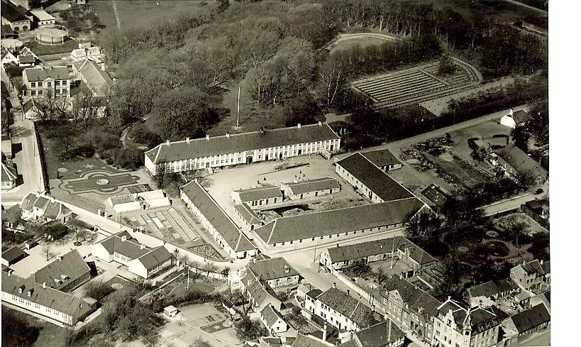
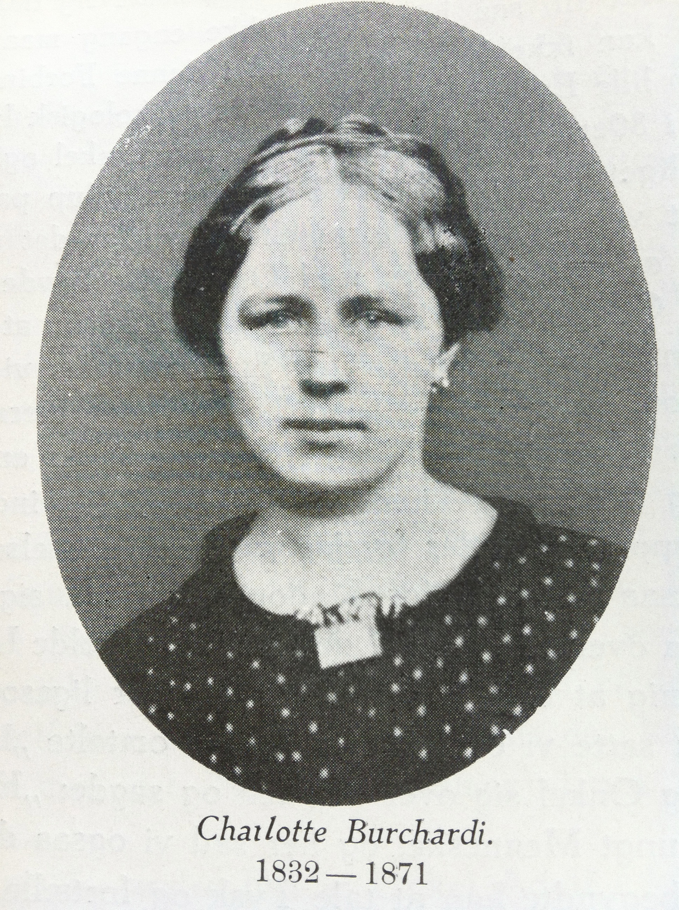

# Familien Lawaetz – 11ty

Static version of https://familien-lawaetz.dk, migrated from WordPress (Twenty Ten theme) to [Eleventy](https://www.11ty.dev/).

## Commands

```bash
npm install
npm start          # dev server with live reload (no search index; images generated on request)
npm run build      # build to _site/ (incl. optimised images in /img/) and the Pagefind search index
```

Deploy by uploading the contents of `_site/` to any static host. **Always run `npm run build` right before
uploading:** while `npm start` runs, `_site/` contains development-only image URLs (`/.11ty/image/…`) that only
work with the dev server. Set `SKIP_IMAGES=1` to skip image processing entirely (faster while writing).

## Structure

| Path | What |
|---|---|
| `src/content/pages/**.md` | WordPress pages. The folder structure mirrors the URL; `parent` + `menuOrder` in front matter drive the menu (same order as WordPress). |
| `src/content/posts/*.md` | WordPress posts (shown on the front page, newest first). |
| `src/_data/site.json` | Site title, tagline, header image, Facebook group link. |
| `src/_data/wp.json` | Categories, tags and approved comments from WordPress. |
| `src/_includes/` | Layouts (`base`, `page`, `post`) and partials (section navigation, post listing entry, comments). |
| `src/css/theme.css` | The "Slægtsbog" theme: colours and fonts as variables at the top, then layout, text, images, footnotes, footer. |
| `src/static/images/vaaben.svg` | Coat of arms, used as logo and favicon. |
| `src/wp-content/uploads/`, `src/pics/` | All media, at the same URLs as on the WordPress site. |

### Theme

- Warm paper background, dark ink and one green accent (`--accent`); all colours are variables at the top of `theme.css`.
- Text in Source Serif 4, self-hosted from the `@fontsource-variable/source-serif-4` package (copied to `/fonts/`, no
  Google Fonts); navigation, dates and captions in the visitor's system sans-serif.
- The top menu lists the top-level pages; `navTitle` in a page's front matter sets a shorter menu label.
  Pages inside a section get the section's page list beside the text (after it on phones) and a breadcrumb.
- The former sidebar lives in the footer (latest posts, Facebook group, search, RSS); search is also in the top menu.

### Content and links

Content files are Markdown, pre-processed by Nunjucks. Write internal links and media as plain root-relative
paths. Eleventy's built-in `HtmlBasePlugin` adds the path prefix (if one is ever configured) to every `href`/`src`
in the generated HTML, so no `url` filter is needed:

```md
[Legatbestyrelsen](/lawaetzer-legatet/legatbestyrelsen/)
```

Web addresses and e-mails don't need link syntax: `https://…`, `www.…` and `navn@example.dk` are linked
automatically, and so is the site's own domain written bare: `familien-lawaetz.dk` (optionally with a path).
Other bare domains like `example.dk` are not (that would also catch "7.000.kr"); write them with
`www.`/`https://` or as a normal Markdown link.

### Images

```md
                       plain image
   with caption
{.alignleft width=150}  floated left, shown 150 px wide
[](/wp-content/uploads/2015/02/poskort.jpg)  click opens the original
```

- An image on its own line becomes a `<figure>`; the quoted title becomes the caption ([markdown-it-image-figures](https://github.com/Antonio-Laguna/markdown-it-image-figures)).
- `{…}` after an image adds classes/attributes ([markdown-it-attrs](https://github.com/arve0/markdown-it-attrs)): `.alignleft`, `.alignright`, `.aligncenter` and `width=…`. Avoid `{#id}`: `{#` starts a Nunjucks comment.
- Every image is processed by [@11ty/eleventy-img](https://www.11ty.dev/docs/plugins/image/): width/height, lazy loading, and WebP + original format at up to 640 and 1280 px (never upscaled). Without `width=` the image is shown at its natural size, at most the 640 px column.
- Several images in one paragraph are shown inline, side by side.

### Footnotes

Footnotes use [markdown-it-footnote](https://github.com/markdown-it/markdown-it-footnote) (standard Markdown footnote syntax):

```md
Otto Lawaetz købte Refsnæsgården[^1] i 1866, og legatet blev stiftet i 1904[^legat].
Inline-fodnoter skrives sådan^[Fodnotens tekst direkte i teksten.].

[^1]: Refsnæsgården ligger på Røsnæs ved Kalundborg. Se [stamtavlen](/stamtavlen/).
[^legat]: Det Otto Lawaetz’ske familielegat.
```

Footnotes are numbered in order of first use (labels like `legat` are only names) and listed under "Fodnoter" at the end
of the page or post. Footnote ids are prefixed with the page's `wpId`, so posts shown together on the front page don't clash.
Footnotes only work in Markdown text, not inside kept HTML blocks (e.g. inside a `<p style="…">`).

### Adding content

- **New page:** add a `.md` file under `src/content/pages/` with front matter
  `layout: layouts/page.njk`, `title`, `wpId` (any unique number), `parent` (the `wpId` of the parent page, or 0), `menuOrder`, `permalink`.
- **New post:** add a file under `src/content/posts/` with `layout: layouts/post.njk`, `title`, `date`, `wpId`, `permalink`.
- Set `modified: "2026-11-15T10:00:00"` when you change a page; it becomes the page's `<lastmod>` in the sitemap.

### Sitemap and robots.txt

`/sitemap.xml` (from `src/sitemap.njk`) lists every page and post, the front page and category pages that have posts,
with `<lastmod>` from `modified`. Add `sitemap: false` to a page's front matter to leave it out (the 404 and search
pages do). `/robots.txt` (from `src/robots.njk`) allows everything except the Pagefind index and points to the sitemap.
Both use absolute URLs built from `site.url` in `src/_data/site.json` plus any path prefix. Note that crawlers only
read `robots.txt` at the root of a domain, so it only takes effect when the site is served without a path prefix.

## What changed compared to WordPress

- All URLs are unchanged (pages, posts, `/category/…/`, `/wp-content/uploads/…`). The RSS feed is at `/feed/index.xml`.
- Search uses [Pagefind](https://pagefind.app/) at `/soeg/` (built by `npm run build`).
- Comments are shown read-only; new comments are closed.
- The Twenty Ten theme is replaced by a new, responsive theme (see Theme above).
- The Facebook widget is a plain link (no Facebook SDK/tracking). Jetpack, CampTix, Wordfence and WPtouch are gone.
- Drafts, private pages, unapproved comments and CampTix attendee records were not migrated.
