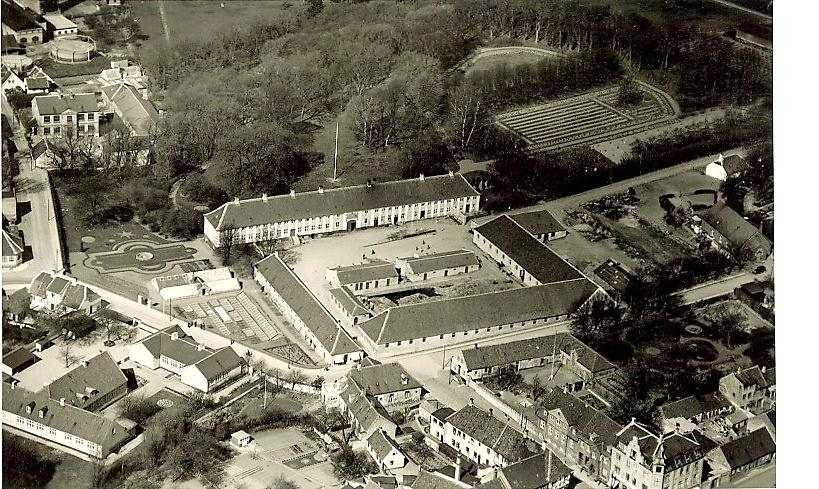

# Vejledning: sider og indlæg på familien-lawaetz.dk

Denne vejledning forklarer, hvordan du opretter og vedligeholder sider og indlæg på hjemmesiden.
Alt indhold ligger som almindelige tekstfiler (Markdown, `.md`), som kan redigeres i en hvilken som helst
teksteditor.

## Sider og indlæg – hvad er forskellen?

| | **Side** | **Indlæg** |
|---|---|---|
| Bruges til | Fast indhold: legatet, gravstederne, arkivet, nyhedsbreve, familiesammenkomster … | Nyheder: "Næste familiesammenkomst", "Slægtsbogen kan nu atter købes" … |
| Vises | I menuen og i sektionens sideliste | På forsiden (nyeste først), i listen over indlæg ved siden af indlæggene og under "Nyt fra familien" nederst på alle sider |
| Mappe | `src/content/pages/` | `src/content/posts/` |

## Hvor skal filen ligge?

### Sider

Mappestrukturen under `src/content/pages/` *er* menuen. En side lægges i mappen for den side, den hører under:

```
src/content/pages/
├── lawaetzer-legatet.md                 → /lawaetzer-legatet/            (i topmenuen)
├── lawaetzer-legatet/
│   ├── legatbestyrelsen.md              → /lawaetzer-legatet/legatbestyrelsen/
│   └── nyhedsbrev-2023.md               → /lawaetzer-legatet/nyhedsbrev-2023/
└── stamtavlen.md                        → /stamtavlen/                   (i topmenuen)
```

- En fil direkte i `pages/` bliver et punkt i topmenuen.
- Undersider lægges i en mappe med **samme navn som den overordnede side** (uden `.md`):
  undersider til `lawaetzer-legatet.md` ligger i mappen `lawaetzer-legatet/`.
- Det kan gå flere niveauer ned, fx
  `gravstederne-pa-refnaes-og-kalundborg-kirkegarde/gravstedet-paa-gjellerup-kirkegaard/gravminde-redningsaktion.md`.

### Indlæg

Indlæg lægges direkte i `src/content/posts/` (ingen undermapper). Adressen bliver filnavnet:
`posts/slaegtsbogen-kan-nu-atter-koebes.md` → `/slaegtsbogen-kan-nu-atter-koebes/`.

## Hvad skal filen hedde?

**Filnavnet bliver sidens adresse**, så vælg det med omhu:

- kun små bogstaver `a–z`, tal og bindestreg `-` – ingen mellemrum
- æ, ø og å skrives `ae`, `oe` og `aa` (fx `slaegtsbogen-kan-nu-atter-koebes.md`)
- kort og beskrivende, gerne med årstal, hvor det giver mening (`nyhedsbrev-2026.md`, `familiesammenkomst-2028.md`)
- endelsen er altid `.md`

> **Pas på:** Omdøber eller flytter du en fil, ændres adressen. Links fra andre sider og fra e-mails
> til den gamle adresse virker så ikke længere. Søg efter den gamle adresse i de andre filer og ret linkene.

## Egenskaber øverst i filen

Hver fil starter med en blok mellem to linjer med `---`. Her står sidens egenskaber, én pr. linje:

```md
---
title: "Nyhedsbrev 2026 fra legatbestyrelsen"
---

Kære familiemedlemmer.

Her begynder selve teksten …
```

| Egenskab | Krævet? | Betydning |
|---|---|---|
| `title` | **ja** | Overskriften på siden/indlægget. Den vises automatisk øverst – skriv den ikke igen i teksten. |
| `date` | nej | Oprettelsesdato, `"ÅÅÅÅ-MM-DDTtt:mm:ss"` (klokkeslættet kan udelades: `"2026-11-17"`). Bestemmer rækkefølgen: nyeste indlæg øverst på forsiden, og sider i menuen sorteres efter dato, nyeste først (se `navOrder`). Udelades den, bruges datoen for, hvornår filen første gang blev gemt i versionsstyringen (git) – også hvis den senere omdøbes eller flyttes. Angiv den, hvis siden skal have en anden dato. |
| `modified` | nej | Dato for seneste ændring, samme format. Normalt kan den udelades: så bruges datoen for, hvornår filen sidst blev gemt i git. Angiv den kun, hvis du vil styre datoen selv. |
| `navOrder` | nej (kun sider) | Fast plads i menuen: `navOrder: 1`, `navOrder: 2` … Sider med `navOrder` kommer først, i nummerorden; resten følger efter dato, nyeste først. Brug den kun til sider, der skal have en fast plads – nye nyhedsbreve og familiesammenkomster sorterer sig selv. |
| `navTitle` | nej (kun sider i topmenuen) | Kortere navn i topmenuen, fx `navTitle: "Legatet"` for "Lawaetzer-legatet". |
| `post` | nej (kun sider) | `post: true` viser siden som et indlæg *også*: på forsiden, i listen over indlæg og under "Nyt fra familien", sorteret efter `date`. Siden beholder sin adresse og sin plads i menuen. Praktisk til fx et nyt nyhedsbrev, der også skal være en nyhed. Skriv en dato i stedet for `true`, fx `post: "2026-11-19"`, så vises og sorteres siden efter den dato blandt indlæggene – i menuen bruges stadig `date`. |
| `hide` | nej | `hide: true` skjuler siden/indlægget – se nedenfor. |

Sæt tekstværdier i anførselstegn (`"…"`), især hvis de indeholder kolon, fx `title: "Lørdag: program"`.

### Skjulte sider og indlæg (`hide`)

```md
---
title: "Udkast til nyhedsbrev 2027"
hide: true
---
```

En skjult side eller et skjult indlæg

- vises **ikke** i menuen, sidelisten, på forsiden, under "Nyt fra familien", i RSS-feedet eller i søgningen
- bliver ikke fundet af Google og andre søgemaskiner
- **kan stadig åbnes** af alle, der kender adressen – praktisk til udkast, som andre skal læse korrektur på.

Undersider til en skjult side forsvinder også fra menuen. Skriv præcis `hide: true` – `hide:` uden værdi skjuler
**ikke**. Når siden skal offentliggøres, sletter du linjen (eller skriver `hide: false`) og sætter `date` til
udgivelsesdatoen.

Vil du fjerne en side helt, så slet filen.

## Tekst (Markdown)

### Afsnit og linjeskift

En tom linje starter et nyt afsnit. Et linjeskift inde i et afsnit laves med `\` sidst på linjen:

```md
Festudvalget er gået i gang med at planlægge næste familiesammenkomst
**lørdag den 20. maj 2028.**\
Sæt allerede nu X i kalenderen!

Indbydelser sendes ud i januar 2028.
```

Almindelige linjeskift uden `\` ignoreres – teksten løber sammen til ét afsnit.

### Overskrifter

```md
## Mellemrubrik
### Mindre mellemrubrik
```

Brug ikke kun `#` (én havelåge) – det er sidens titel, og den kommer fra `title`.

### Fed og kursiv

```md
**fed tekst**    _kursiv tekst_    **_fed og kursiv_**
```

### Lister

```md
- Clara Lawaetz (formand)
- Carl Lawaetz Gabe
- Marianne Lawaetz

1. Første punkt
2. Andet punkt
```

### Citater

```md
> ”Det var et hyggeligt og kærligt Familieliv, der blev ført i Forpagterlejligheden paa Ladegaarden.”
```

Et langt citat over flere afsnit: start hver linje (også de tomme imellem) med `>`.

### Links

```md
Læs mere om [legatbestyrelsen](/lawaetzer-legatet/legatbestyrelsen/).
Se [Kalundborg Kommunes hjemmeside](https://kalundborg.dk).
Hent [fundatsen som PDF](/wp-content/uploads/2016/12/fundats.pdf).
```

- Links til sider på hjemmesiden skrives med adressen alene, startende med `/` (ikke `https://familien-lawaetz.dk/…`).
- Webadresser og e-mails bliver automatisk til links – ingen særlig syntaks:
  `https://www.dr.dk`, `www.dr.dk`, `navn@example.dk` og `familien-lawaetz.dk`.
- Andre adresser uden `www.` eller `https://` (fx `dr.dk`) bliver **ikke** til links; skriv dem med
  `www.`/`https://` eller som et link `[tekst](https://dr.dk)`.

### Billeder

Billeder og andre filer (PDF'er) lægges i `src/wp-content/uploads/ÅÅÅÅ/MM/` (år og måned for, hvornår de
blev lagt op), fx `src/wp-content/uploads/2013/01/kaaludkloster.jpg`. I teksten skrives adressen uden `src`:

```md

```

- Teksten i `[…]` beskriver billedet for blinde og svagsynede – skriv kort, hvad billedet viser - kan være tom.
- Filnavne på billeder: samme regler som ovenfor (ingen mellemrum, helst ingen æøå).

| Ønske | Skriv |
|---|---|
| Billedtekst under billedet | `` |
| Bestemt bredde (pixels) | `{width=150}` |
| Til venstre, teksten løber udenom | `{.alignleft width=150}` |
| Til højre, teksten løber udenom | `{.alignright width=150}` |
| Centreret | `{.aligncenter width=640}` |
| Klik åbner en anden fil (fx originalen i fuld størrelse) | `[{width=208}](/wp-content/uploads/2024/11/Foer-afrensning.jpeg)` |
| Billedet skal ikke kunne klikkes | `{.nolink}` |

- Et klik på et billede åbner det i fuld størrelse – det sker automatisk.
- Et billede på sin egen linje (med tom linje før og efter) står for sig selv; flere billeder i samme afsnit
  vises ved siden af hinanden.
- Uden `width` vises billedet i sin naturlige størrelse, dog højst i tekstkolonnens bredde. Du behøver ikke selv
  gøre billederne mindre – store fotos skaleres automatisk ned til visning.
- `{…}` skal stå lige efter `)`, uden mellemrum.

### Fodnoter

```md
Otto Lawaetz købte Refsnæsgården[^1] i 1866, og legatet blev stiftet i 1904[^legat].

[^1]: Refsnæsgården ligger på Røsnæs ved Kalundborg.
[^legat]: Det Otto Lawaetz’ske familielegat.
```

Fodnoterne nummereres automatisk i den rækkefølge, de bruges, og vises under "Fodnoter" nederst på siden.
Navnet efter `^` (`1`, `legat`) er kun et mærke, der forbinder henvisningen med noten.

### Tegn, du skal undgå

Skriv ikke `{{`, `{%` eller `{#` i teksten – de tegnkombinationer har en særlig betydning og ødelægger siden.

## Tjekliste: nyt nyhedsbrev

1. Opret filen `src/content/pages/lawaetzer-legatet/nyhedsbrev-2027.md`.
2. Øverst: `title` (`date` kan udelades – så bruges dagens dato, når filen gemmes i git).
3. Læg eventuelle billeder i `src/wp-content/uploads/2027/MM/`.
4. Skriv teksten. Nyhedsbrevet placerer sig selv øverst blandt nyhedsbrevene i menuen.
5. Skal nyhedsbrevet også være en nyhed på forsiden, så tilføj `post: true` øverst.
