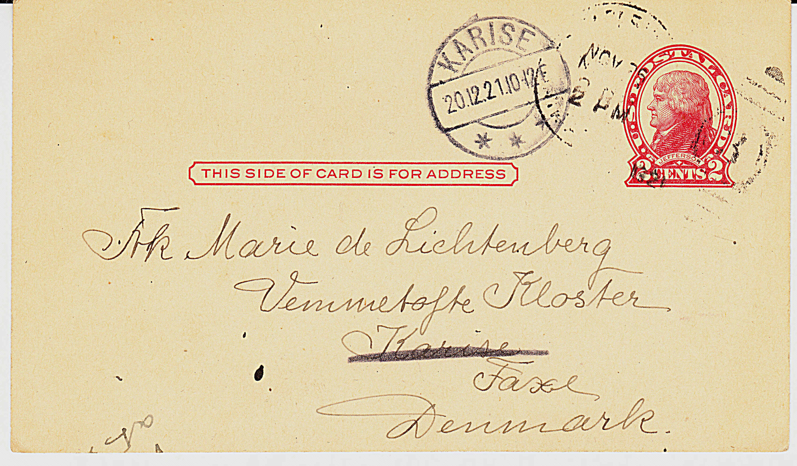
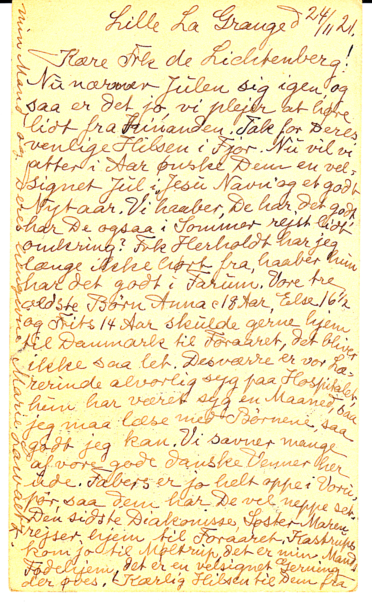

Legatets bestyrelse har modtaget disse billeder fra slægtsforsker Erik Frederiksen. Brevkortet er forfattet af Marie Lawaetz fra Sct. Croix og er dateret i 1921.

[{width=640}](/wp-content/uploads/2015/02/poskort-Marie-Lawaetz-1921.11.24.jpg)

[{width=627}](/wp-content/uploads/2015/02/postkort-Marie-Lawaetz-1921.12.11.jpg)