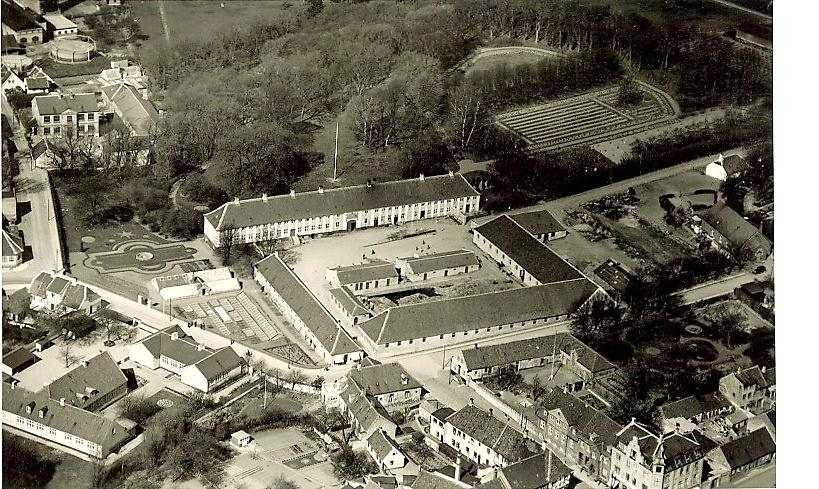
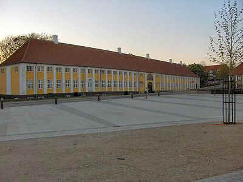

<a href="/wp-content/uploads/2013/02/Invitation-til-2013-Lawaetz-Families.-4.2.2013.pdf">Hent invitationen som PDF.</a>

Lawaetz Familiesammenkomst i Kalundborg ved Kaalund Kloster\
Lørdag den 25. maj 2013 kl. 10.00

[{width=640}](/wp-content/uploads/2013/01/kaaludkloster.jpg)

Festudvalget indbyder hermed alle til en hyggelig og interessant sammenkomst for slægten Lawaetz.

<h1 class="entry-title">Dagens program</h1>

<table style="border-width: 0;"><tbody><tr><td style="vertical-align: top; border-width: 0;">10.00</td><td style="vertical-align: top; border-width: 0;">Vi mødes i Vor Frue Kirke i Kalundborg til en lille andagt, efterfulgt af et foredrag ved historiker Søren Juul, der vil sætte Kalundborg, Kaalund Kloster og Lawaetz familien på Kaalund Kloster i et historisk perspektiv.</td></tr><tr><td style="vertical-align: top; border-width: 0;">12.15</td><td style="vertical-align: top; border-width: 0;">Frokost på Restaurant Gisseløre.</td></tr><tr><td style="vertical-align: top; border-width: 0;">14.15</td><td style="vertical-align: top; border-width: 0;"><strong style="color: red;">præcis! Gruppefotografering i haven bagved Kaalund Kloster. Efterfølgende deles vi i 2 hold.</td></tr><tr><td style="vertical-align: top; border-width: 0;">14.30</td><td style="vertical-align: top; border-width: 0;">Hold A: Fortælling og rundvisning ved Kaalund Kloster. Hold B: Fortælling og rundvisning på Kalundborg Kirkegård.</td></tr><tr><td style="vertical-align: top; border-width: 0;">15.00</td><td style="vertical-align: top; border-width: 0;">Hold B: Fortælling og rundvisning ved Kaalund Kloster. Hold A: Fortælling og rundvisning på Kalundborg Kirkegård.</td></tr><tr><td style="vertical-align: top; border-width: 0;">15.30</td><td style="vertical-align: top; border-width: 0;">Medbragt kaffe/the/drikkelse til børn i haven. Festudvalget sørger for hjemmebag.</td></tr><tr><td style="vertical-align: top; border-width: 0;">17.00 (ca.)</td><td style="vertical-align: top; border-width: 0;">Afsked og på gensyn.</td></tr></tbody></table>

<h1 class="entry-title">Lidt historie om Kaalund Kloster</h1>

I ca. 1170 anlagde Esbern Snarre en borg ved Hærvig, som fik navnet Kalundborg. Borganlægget lå på en tresidet borgbanke ved vestenden af en større banke, hvor byen fik sin plads. Borgen gik over til Esbern Snarres datter, Ingeborg af Kalundborg, indtil den blev inddraget under Kronen i 1262, fordi Ingeborg havde støttet Abels slægt i kamp mod kongen.\
Formodentlig ca. 1300 blev by og borg omsluttet af en kunstigt opstemmet sø, Munkesøen, og ved byens østende anlagdes en ny borg. Denne blev i 1350’erne kraftigt udbygget af Valdemar den 4. Atterdag, som samtidig omgav byen med en ringmur.\
Den vestre borg tjente ved middelalderens slutning udelukkende som staldgård. Den østre borg, der herefter entydigt omtales som Kalundborg Slot, var et efter danske forhold usædvanlig kraftigt, koncentrisk anlæg med dobbelt ringmur omkring et femfløjet bygningskompleks. Af de fem ydre ringmurstårne var det største “Folen”; det tjente som statsfængsel, og her havde rigets arkiv til huse indtil 1582.\
I 1549 blev Christian den 2. overført til Kalundborg Slot, hvor han levede de sidste ti år af sit liv.\
Slottet blev nedrevet under den svenske besættelse 1658-60. I et lille, grønt anlæg ses ruiner af “Folen” og slottets ydre ringmur. Ruiner af den ældre, vestre borg og byens ringmur kan ses i parken Lindevænget vest for højbyen.

Inden Kalundborg i 1262 overgik til kronen, var der ved Ingeborg af Kalundborgs slægtning, Ingegerd af Regensteins hjælp, givet en grund tæt ved slottet til et kloster for den ny franciskanerorden, der i Danmark også kaldtes Gråbrødrene. Klostret er sandsynligvis grundlagt allerede i år 1230, men er formodentligt standset i væksten pga. de følgende års urolige tider. Der vides ikke meget om klostrets historie, dog har det på et tidspunkt virket til at spille en væsentlig rolle i ordenens historie i Danmark. Klostret kom under reformationen i 1500-tallet til Kronen, der gjorde det til ladegård for Kalundborg Slot.

Kalundborg Slots Ladegård var ejet af Kronen og under skiftende lensmænd indtil 1664. Den 14. august 1664 fik storkøbmand Gabriel Marselis alt krongods i Kalundborg Amt, deriblandt Kalundborg Slots Ladegård, tilskødet som afdrag på kronens store gæld til ham. Sønnen Frants Marselis overtog gården og ejede den indtil 1702. I 1687 fik han gården gjort til en fri sædegård (synonymt med hovedgård eller herregård og fri for bl.a. alle jordskatter).

I 1742 blev gården erhvervet af general af kavalleriet Christian Lerche (1712-1793), som i forvejen ejede Lerchenfeldt og i de følgende år skabte et stort godskompleks i Nordvestsjælland, her i blandt Kalundborg Slots Ladegård, Birkendegård og Østrupgård. I 1755 oprettedes stamhuset Lerchenborg og Østrupgård ændrede navn til Lerchenborg.\
Grev Lerche opførte på de fleste af gårdene nye hovedbygninger og også Kalundborg Slots Ladegård nød godt af hans byggelyst. Han nedrev resterne af klostret og opførte 1751-52 den nuværende, meget langstrakte enlængede hovedbygning sammen med et trefløjet ladegård anlæg. Hovedbygningen er 87m lang, er i 2 stokværk og er bygget i rokokostil, arkitekten var formentlig J.C. Conradi. Da gården ved opførelsen var avlsgård under Lerchenborg gods, har hovedbygningen aldrig været tænkt som herskabsresidens. Den sydlige del var oprindelig indrettet til beboelse, mens den nordre indeholdt mejeri og andre funktioner i forbindelse med landbrugsdriften. Over porten ud til gaden ses Lerches våbenskjold.

**Otto Friederich Christian Anton Lawaetz** (1829-1914) købte i 1887 Kalundborg Slots Ladegård. Han havde siden 1860 haft gården i forpagtning og havde siden 1866 også været ejer af Refsnæsgård. Otto Lawaetz var oplært i mejeribrug og havde været mejeriforpagter på flere store gårde.\
Han var forgangsmand indenfor det moderne landbrug og mejeridrift og engagerede sig som ivrig debattør og skribent i det landbrugsfaglige område og hans landbrug og mejeri blev læresteder for et stort antal mandlige og kvindelige elever. Han var en streng læremester, der stillede store krav til arbejdsomhed, og som indre missionsmand med et alvorligt religiøst sind, påvirkede han sine elever til pligtfølelse og nøjsomhed. Otto Lawaetz havde endvidere indflydelse både som praktisk foregangsmand og gennem sin offentlige virksomhed på bl.a. oprettelse af landboforening, sygekasse, brugsforening, spare- og lånekasse.\
Otto Lawaetz var gift 1. gang med Anne Charlotte Pauline Burchardi (1832-1871) og 2. gang med Benthea Cathinka Volck (1839-1920). Med Charlotte fik han 10 børn og med Cathinka 6.

Sønnen **Carl Anton Nicolai Lawaetz** (1868-1944) købte Kalundborg Slots Ladegård i 1912 efter at have været forpagter på denne siden 1900.\
Han ejede også Løvegård 1907-1921, Falkensteen 1911-1933, Refsnæsgård fra 1914 samt lillebæltsøen Fænø 1921-1935.\
Han havde i sin tid som forpagter på Rudbjerggård ved Nakskov fået interesse for sukkerroedyrkning og sukkerfabrikation og stiftede i 1911 sukkerfabrikken Vestsjælland i Gørlev. Der var på Kaalund Kloster en meget stor besætning køer og deraf mejeridrift. Carl Lawaetz beskrives som en temperamentsfuld mand, en dygtig administrator af sine landejendomme og som en ihærdig forsvarer for det store landbrugs interesser og dets nationaløkonomiske betydning.

Carl Lawaetz giftede sig med Kirstine Gyring (1877-1954).\
Han valgte at give gården navneforandring tilbage til Kaalund Kloster, da den kalundborgjyske dialekt gjorde udtalen af ”Ladegården” mindre pæn. I 1942 overdrog han gården til sine 8 børn, der solgte den i 1946.\
Avlsbygningerne blev revet ned i 1949 og hovedbygningen fungerede frem til 1963 som et skolehjem. I 1963 købte Kalundborg Kommune hovedbygningen og gjorde den til byens rådhus. Den sydlige ende af\
bygningen raseredes i 1975 af en brand, men blev efterfølgende genopbygget. Kaalund Kloster fungerer i dag fortsat som en del af Kalundborg Kommunes administrative bygninger.
