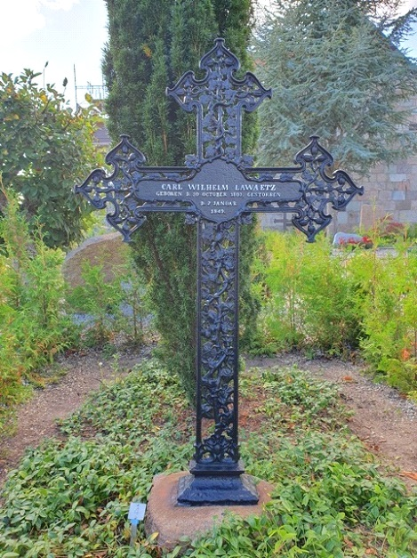

Uddrag fra “Den lille guide til Gjellerup Kirkegård” af Charlotte Lindhardt, side 78. (Afdeling C, række 1, nr 4. Carl Wilhelm Lawaetz):

“Dette smukke kors er det eneste tyske kors på kirkegården. Der står nemlig “Geboren” og “Gestorben” i stedet for “Født” og “Død”, hvilket skyldes, at den afdøde var af tysk afstamning.

Carl Wilhelm Lawaetz var mejeriforpagter på Herningholm og i Bjødstrup. Han var født i Pløn sydøst for Kiel, og området var på det tidspunkt dansk, men der var også en stor tysktalende befolkning, som Lawaetz tilsyneladende tilhørte.

Han døde af en brystsygdom og efterlod sig hustruen Sophie Magdalene Siegmund, som også var fra Holsten og fortsatte med at drive mejeriet videre, og mindst fem børn. Af folketællingen i 1850 kan man se, at enken havde titel som mejeriforpagterinde, mens den ældste søn, Otto, nu var bestyrer.

I 1800-tallet kom der mange tyske mejerister til landet, både mænd og kvinder, for det at være en dygtig mejerske var et højt værdsat kvinderhverv. De arbejdede på større gårdes mejerier, som også kunne dække nærområdet. Da andelstanken vandt frem, og Hjedding Andelsmejeri ved Ølgod blev oprettet som landets første i 1882, begyndte flere gårdmænd at gå sammen om selvstændige mejerier uden for gårdene.”

---

**Carl Wilhelms Forpagtningscontract fra 1844 med Herningsholm kan læses i sin fulde udstrækning på denne hjemmeside under rubrikken _“Arkiv”_.**
