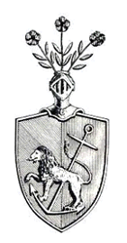{.alignleft}

Den første Lawaetz’er (med ae), der bosatte sig i Kongeriget Danmark i 1837, Carl Wilhelm Lawaetz, ligger begravet på Gjellerup Kirkegård ved Herning. Carl Wilhelm er faktisk for-far til alle danske Lawaetz’ere, der staves med ae.\
Carl Wilhelm døde fra hustruen, Sofie, og fem børn i en alt for ung alder i 1849, og hans grav har familien kunnet besøg i nu mere end 174 år!

På graven står et meget sjældent og bevaringsværdigt støbejernskors, som familiemedlemmer i alle disse år samvittighedsfuldt har gjort deres bedste for at vedligeholde.

I sensommeren 2022 kunne man desværre konstatere, at gravkorset nu var så voldsomt medtaget, at der måtte professionel bistand til, hvis korset skulle bevares for eftertiden. Tre af landets dygtigste konservatorer vurderede uafhængigt af hinanden, at det sjældne og bevaringsværdige gravkors var under nedbrydning, og at der burde handles hurtigt, hvis korset skulle reddes og bevares. De anbefalede alle tre en professionel korrosionsbeskyttende behandling, og det billigste tilbud på denne restaurering var på 51.000 kr.

Ansvaret for Carl Wilhelms gravsted er bundet til fundatsen til Det Otto Lawaetz-eske Familielegat. Otto Lawaetz fra Refsnæsgården er ældste søn af Carl Wilhelm og Sofie, og legatet har også ansvaret for at bevare Sofies og Ottos plus hans to hustruer Charlotte og Katinkas gravsteder i Kalundborg og på Røsnæs.

Legatets årlige renteafkast på for tiden ca 7.000.kr. rakte desværre slet ikke til at finansiere denne bevaringsopgave. Legatet fik desuden afslag på to søgte fonde, så i maj 2023 iværksattes en indsamling inden for familien. Den forløb over al forventning, og i løbet af sommeren blev der indsamlet 44.500 kr. Restaureringsabejdet kunne sættes i gang.

FLOT OG STOR, STOR TAK for den fine opbakning. Et smukt udtryk for familiefællesskab.

I nogle tørvejrsdage i august og september 2023 udført en korservator fra Konserveringscenter Vejle en omhyggelig restaurering af korset: forsigtig afrensning, der blotlagde smukke og interessante detaljer; grundig påsmøring af korrosionsbeskyttende rustprimer (det orange lag); grafitholdig barrieremaling (det grå lag) og endelig sort slutmaling med hvid opmaling af den interessante tysksprogede inskription.\
Her på hjemmesiden under ”gravsteder” kan man finde to billedserier fra Gjellerup: gravkorset før og gravkorset under istandsættelsen.

Kommer man på Herningegnen, er Gjellerup Kirkegård og kirke i øvrigt virkelig et besøg værd. Carl Wilhelms gravsted finder man stik øst for kirken tæt ved kirkegårdsmuren og den lille parkering.\
Det kan desuden anbefales også at besøge både Herningsholm, nu museum, og Møltrup, hvor Carl Wilhelm og siden hans enke og sønner virkede som henholdsvis mejeriforpagtere og for Møltrups vedkommende også forpagter af hele hovedgården. (Carl Wilhelm og familiens liv på Herning-egnen kan man læse om i slægtsbogen “Otto Lawaetz, hans liv og gerning tillige med blade af slægten Lawaetz’s historie” på siderne 42-76)\
God fornøjelse!

Marianne Lawaetz

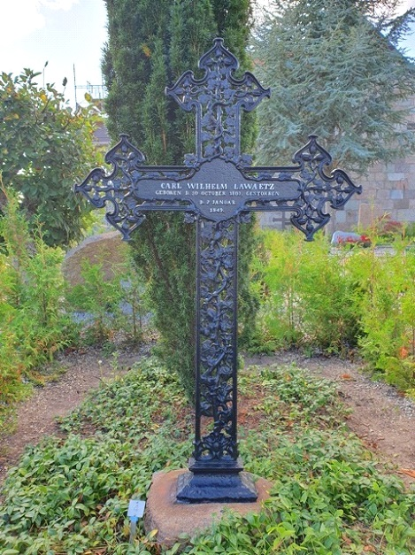 
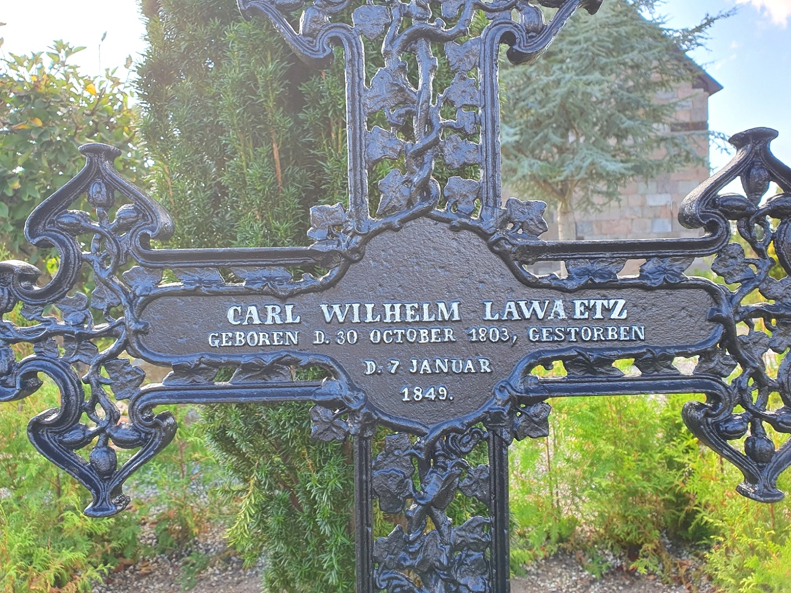
[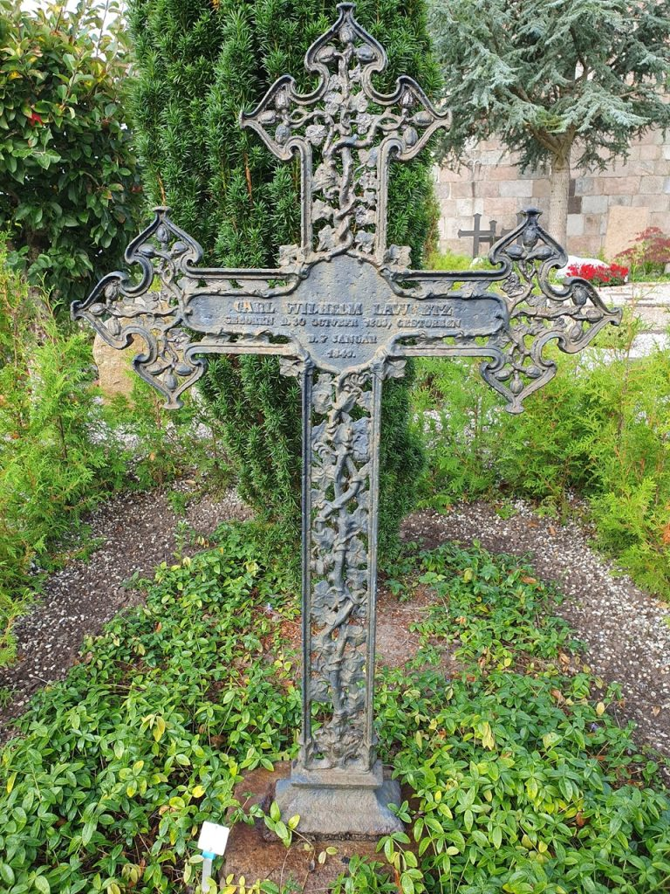{width=208}](/wp-content/uploads/2024/11/Foer-afrensning.jpeg)
[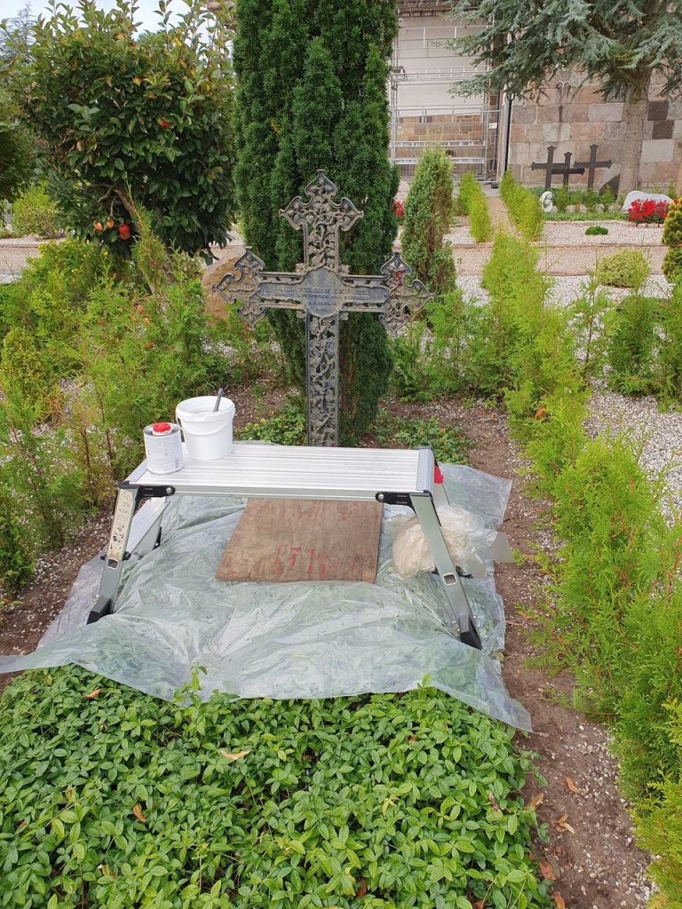{width=208}](/wp-content/uploads/2024/11/Klar-til-afrensning.jpeg)
[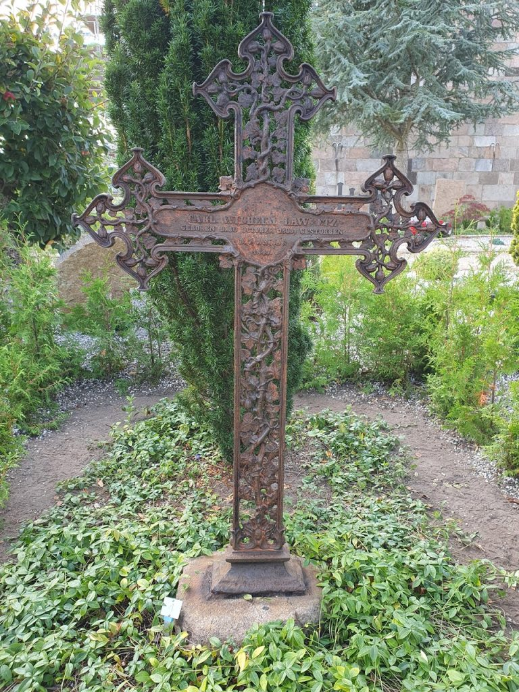{width=208}](/wp-content/uploads/2024/11/Efter-afrensning.jpeg)
[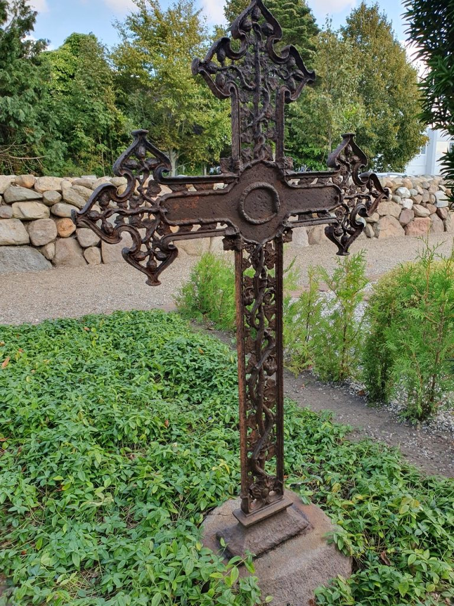{width=208}](/wp-content/uploads/2024/11/Bagside-efter-afrensning.jpeg)
[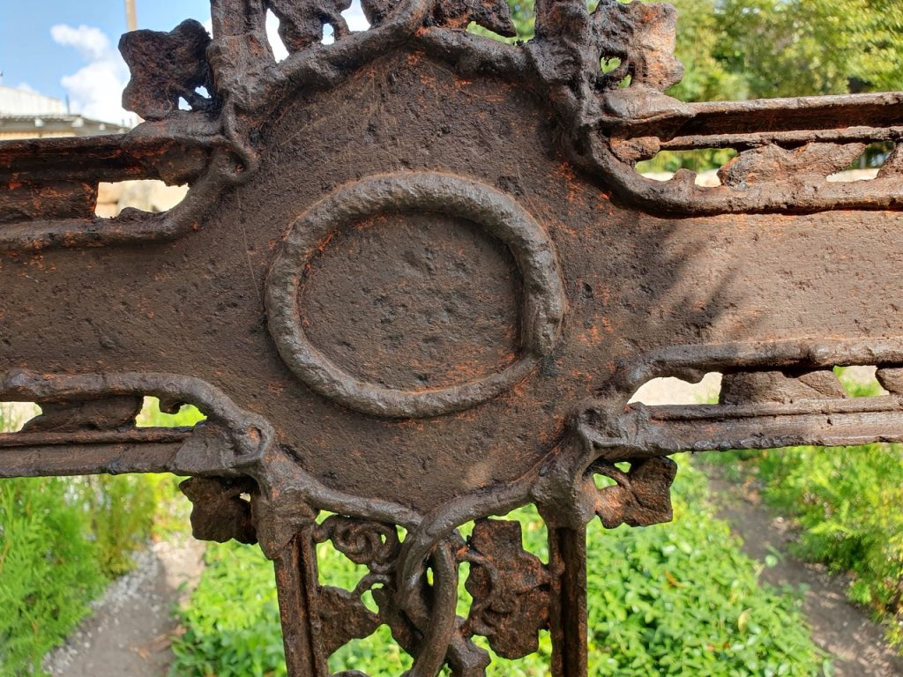{width=208}](/wp-content/uploads/2024/11/Detalje-fra-bagsiden.-En-slangeder-bider-sig-selv-i-halen.-Evighedssymbolet.jpeg)
[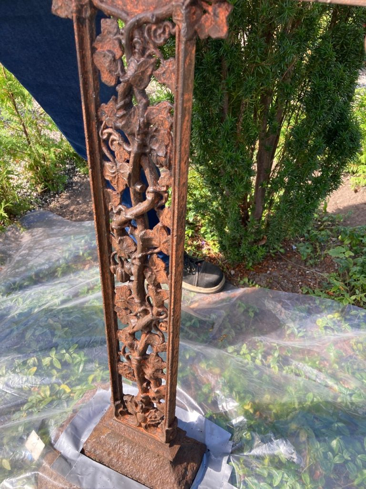{width=208}](/wp-content/uploads/2024/11/Detaljer.jpeg)
[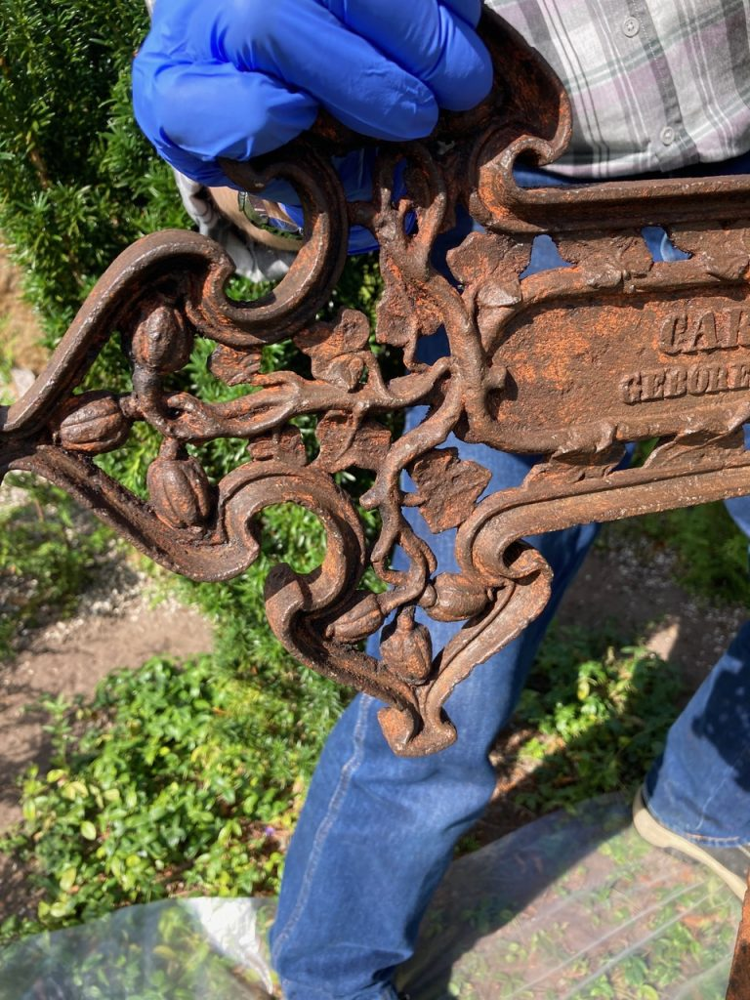{width=208}](/wp-content/uploads/2024/11/Fine-detaljer.jpeg)
[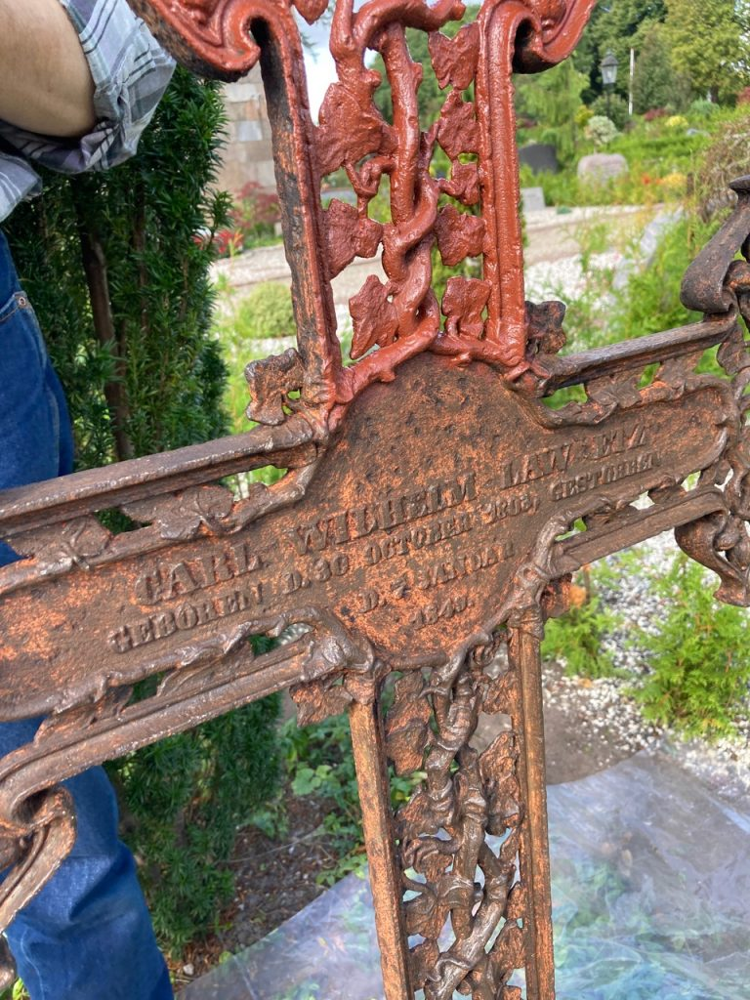{width=208}](/wp-content/uploads/2024/11/Behandling-med-rustprimer.jpeg)
[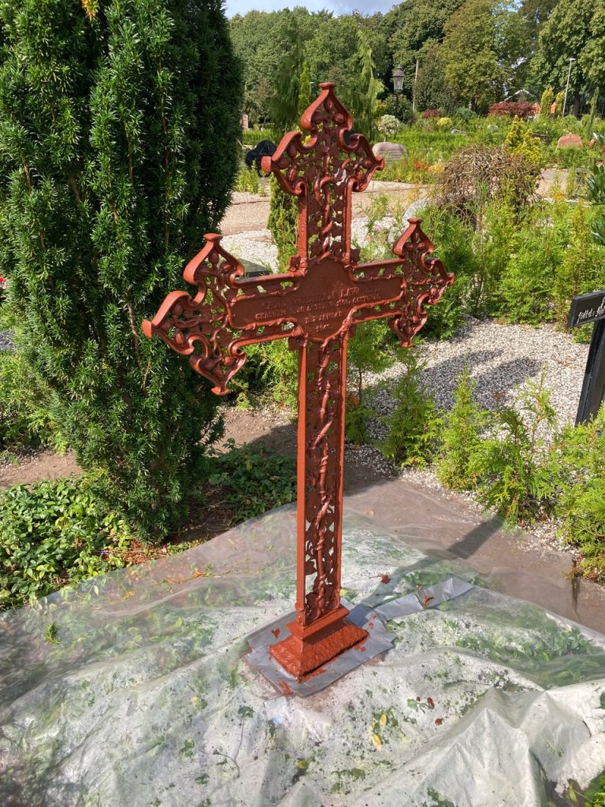{width=208}](/wp-content/uploads/2024/11/Rustprimer.jpeg)
[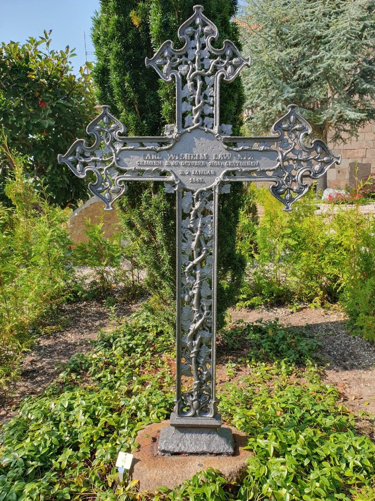{width=208}](/wp-content/uploads/2024/11/Grafital-barriermaling.jpeg)
