_Af Marianne Lawaetz_

[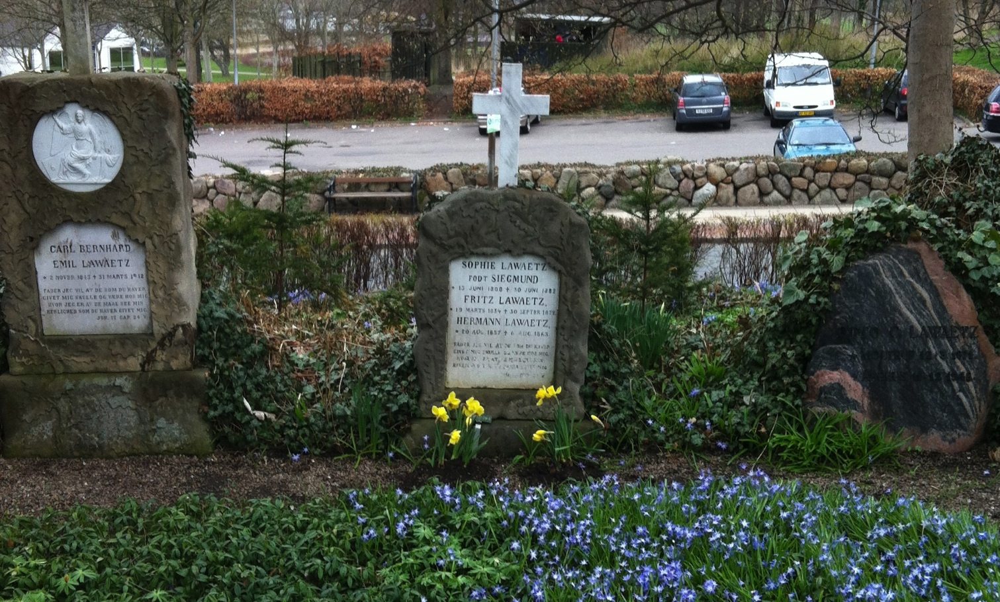{.aligncenter width=640}](/wp-content/uploads/2013/05/Gravsted.jpg)\
Vi står nu ved et af de gravsteder, som Familielegatet sørger for bliver bevaret og vedligeholdt, og jeg vil fortælle jer om de personer, der ligger begravet her.\
(Det vil muligvis fremme overskueligheden at følge med i den forenklede stamtavle sidst i teksten)

Vi har Sophie Magdalene Lawaetz, tre af hendes sønner og et enkelt barnebarn.

[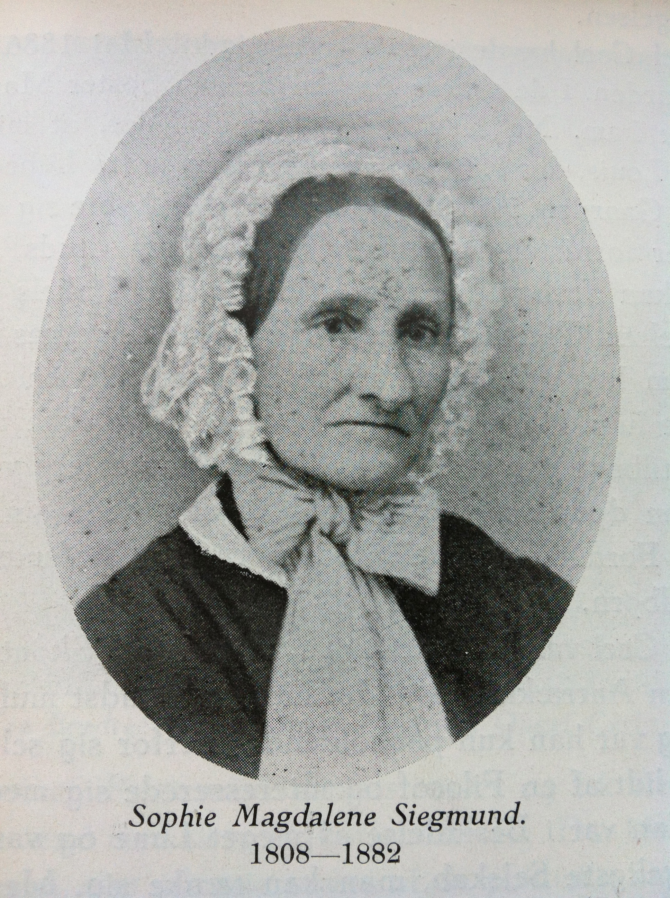{width=150}](/wp-content/uploads/2013/05/SophieMagdaleneSiegmund.png)[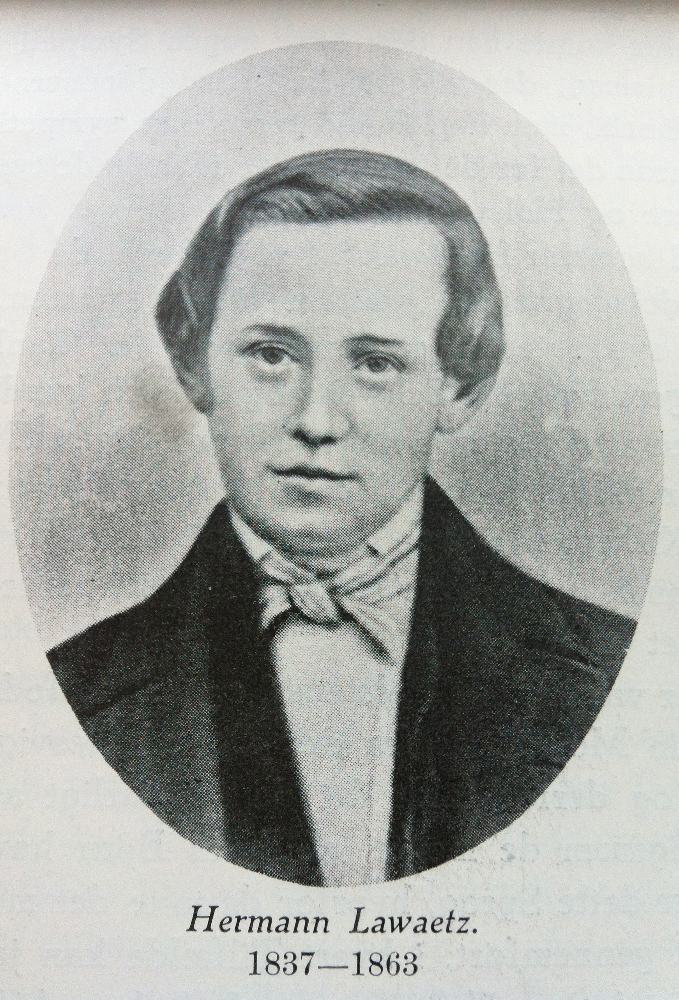{width=150}](/wp-content/uploads/2013/05/HermannLawaetz.png)[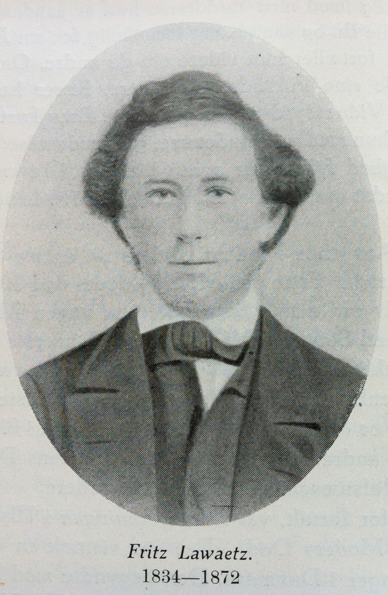{width=150}](/wp-content/uploads/2013/05/FritzLawaetz.png)[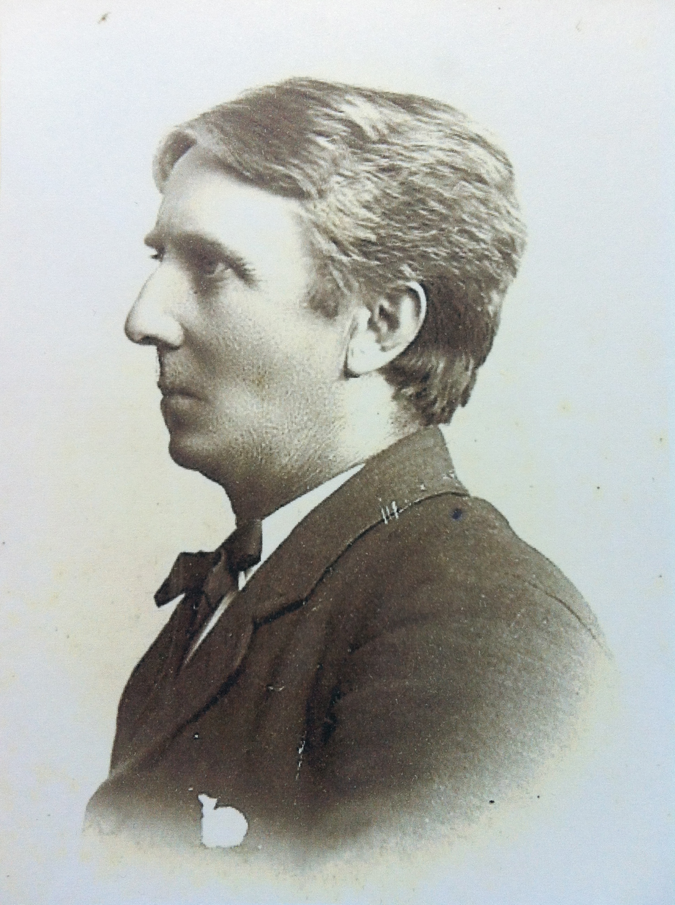{width=150}](/wp-content/uploads/2013/05/Carl.png)

Den ældste er Sophie Lawaetz, født Siegmund. Hun er født 1808 i den tysktalende del af Hertugdømmerne, hendes far var skovrider i nærheden af Pløn, og det var også her i nærheden af Pløn hun mødte sin mand, Carl Wilhelm Lawaets, som lige havde købt sig en lille bondegård. De blev gift i 1828, da Sophie altså var 20 år. Det var et meget lykkeligt ægteskab, og allerede året efter kom det første barn, Otto Friedrich Christian Anton (ham, der som voksen kom til Refsnæs og Kålundkloster). De fik i tidens løb fem sønner: Otto, Heinrich, Fritz, Herman og Carl Bernhard.

[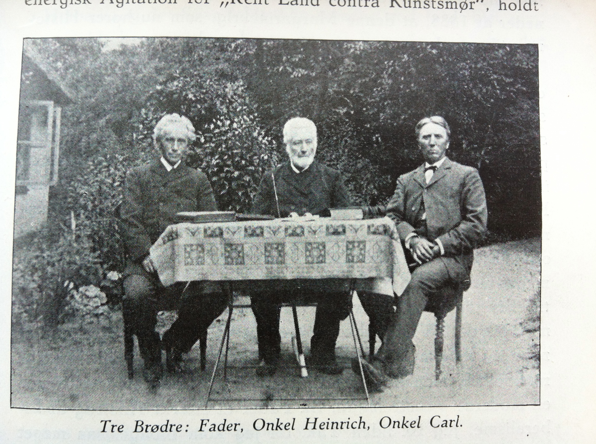{.alignleft width=640}](/wp-content/uploads/2013/05/Tre-br%C3%B8dre.png)

Carl Wilhelm og Sophie afhændede ret snart deres gård. Herefter fik de forskellige mejeriforpagtninger, hvor Sophie naturligvis hjalp med både malkning og mælkebehandlingen. De kom til at flytte en del, og til tider var det vanskeligt at få det til at løbe rundt; ja, på et tidspunkt gik de ligefrem fallit. I familiens flytten rundt blev det ofte nordpå, og i 1838 bosatte familien sig første gang i Kongeriget – tæt ved Christiansfeld. I drengenes barndom var faderens helbred ofte temmelig dårligt. Han led så meget af Astma eller måske tuberkulose, at han ofte ikke kunne tåle at gå på malkepladsen om morgenen; så meget tidligt lærte også drengene at hjælpe til med kvæget og malkningen.

Vi springer nu op til nytåret 1849, og på det her tidspunkt er familien bosat på Herningegnen og har mejeriforpagtningen på Bjøstrup. Det går godt for familien, og faderen har det bedre. Deres ældste søn, Otto, er flyttet hjemmefra 1848. Han skulle have lært landbrug i Holsten, men på grund af krigen med Tyskland, var det en umulighed, så han havde fået sin egen mejeriforpagtning på Lavlund Mejeri. Henrich læste flittigt hos præsten i nabosognet, der således ville hjælpe ham på latinskole og senere til en boglig uddannelse. (Som I kan se på stamtavlen, blev han senere præst i Ulkebøl på Als. Altså Ulkebølgrenen.)\
Men 1849 ,søndag efter nytår sker der imidlertid den katastrofe for familien, at faderen, Carl Wilhelm, dør – kun 45 år gammel. Han bliver begravet på Gjellerup Kirkegård. (Også dette gravsted sørger Legatet for bliver bevaret for eftertiden.) Otto må flytte hjem igen og være familiens overhoved – forsørge moderen og de fire brødre, hvoraf den yngste, Carl, kun er 6 år.\
(Mange detaljer om Sofies ægtemand, ægteskabet og den gribende beretning om hendes mands død og hvor vanskeligt det er at klare sig herefter, kan der læses om i Slægtsbogen)

Vi springe nu til 1853. Heinrich er optaget i latinskolen i Pløn, og han bor hos noget familie, Fritz er nu 18 år og i stand til at forestå bedriften på Bjøstrup. Samtidig får Otto tilbudt mejeriforpagtningen og senere hele forpagtningen af Møltrup – også tæt ved Herning. Lige forinden var Otto blevet forlovet med Charlotte Burcardi, og de giftede sig året efter.

[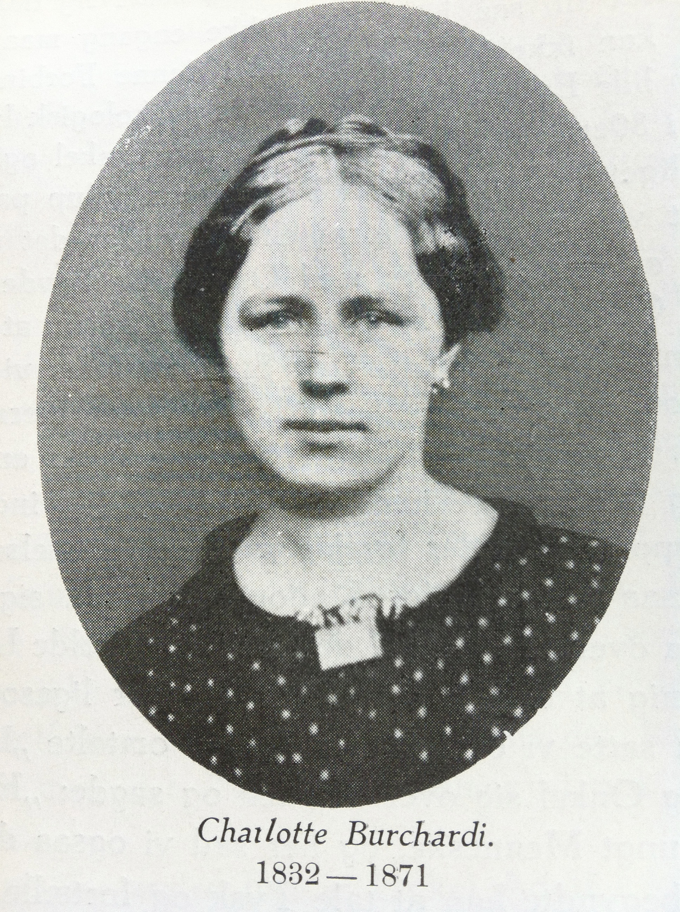{.alignleft width=150}](/wp-content/uploads/2013/05/Charlotte-Burcardi.png)

Efter få og lykkelige år på Møltrup tilbyderen ejeren, at Otto kan få mejeriforpagtning på Birkendegård her lidt uden for Kalundborg, og Otto fik det samtidig ordnet således, at broderen Fritz får forpagtningen på Møltrup, hvor han flytter hen med sin mor og de to yngste brødre.

Otto og Charlotte – og deres to småpiger – flyttede som sagt til Birkendegård, men allerede samme vinter får de tilbudt mejeriforpagtningen her på Kålundkloster. Og efter et halvt år får Otto endda forpagtningen af hele Kålundkloster, eller Kalundborg Slots Ladegård, som den også kaldtes. Det blev nu ordnet sådan, at Charlottes bror, Adolf Burchardi fik mejeriforpagtningen af Birkendegård. Ham og hans virke der er der faktisk skrevet flere bøger om!

Samtidig med at Otto og Charlotte i maj 1860 – nu med tre børn -flytter ind i mejeriforpagterboligen i gårdens nordlige ende – lige neden for kirkegården, flytter også Ottos mor og de to yngste brødre Herman på 23 år og Carl på 17 år ind. Ottos mor, Sophie havde jo hidtil styret hus for Fritz på Møltrup, men han var nu blevet gift, så derfor flyttede hun ind her hos sin ældste søn.

[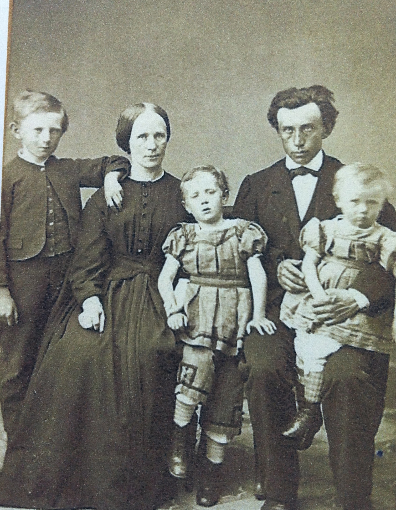{.alignleft width=232}](/wp-content/uploads/2013/05/OttoLawaetzMedFamilie.png)

En af Ottos sønner, Hermann, beretter senere om familielivet på Kålunkloster følgende:

> ”Det var et hyggeligt og kærligt Familieliv, der blev ført i Forpagterlejligheden paa Ladegaarden. Det er ikke altid saa let at have en Svigermor i Huset, men for min Moder var det både let og kært. For os ældre, der har kendt Bedstemoder, falder det ikke svært at forstaa, og for dem, der har kendt moder, endnu mindre. Og hvad brødrene angaar, da var Fader og Onkel Hermann som David og Jonathen, og Onkel Carls tørre Lune og morsomme Indfald har sikkert givet Anledning til megen uskyldig Fornøjelse.”

I sommeren 1863 rammes familien imidlertid igen af en stor sorg, idet Herman, få dag før sin 26-års fødseladag, dør af Tyfus. Otto var også ramt af sammen sygdom, så han kunne ikke engang komme med til begravelsen. De to brødre var som lige omtalt meget tæt forbundne – næsten som tvillinger, så det har været et hårdt slag for alle.

En ung mand, der året efter – i 1864 -ankommer som landvæsenselev på Kålundkloster, fortæller om mødet med Sophie og resten af familien i forpagterboligen:

> ”… Jeg blev ikke modtaget med noget større Ceremoniel. I Forstuen anbragte jeg mit tøj paa en Knagerække, hvorunder stod en lang, lav kasse, inddelt i mange smaa Rum som Hønsereder; De viste sig senere at være til de respektive Ejeres Træsko – meget praktisk. Derefter bankede jeg paa Døren og traadte ind i en stor Stue, tarveligt men pænt møbleret, med Klaver; hvad der særlig tiltrak sig min Opmærksomhed var to Akacietræer i store grønmalede Baljer i Mandshøjde – pragtfulde. Mens jeg stod og betragtede dem, gik Døren op, og en Kvindeskikkelse viste sig, hun var sandelig ikke prægtig at skue, og var det Modellen paa det øvrige kvindelige personale, syntes det ikke lovende, hun lod til at være sammenføjet af Trekanter, alt var spidst og kantet, og med en Stemme saa kold bød hun mig ind i Spisestuen. _Her traf jeg først ”Grossmutter”, Hr.Lawaetz’ Moder, en elskelig gammel Kone (56 år…) med et inderligt mildt Øje, som dog synes at fortælle om megen Sorg, men ogsaa om Fred, samt&nbsp;Husfruen (Charlotte), der var noget af det blideste og venligste, men kunde tænke sig, omgivet af tre Smaapiger og en Dreng. Sproget i Familien var Tysk, men ellers upaaklageligt Dansk i Tiltale. Saa kom Forpagterens Broder Carl, der i daglig Tale gik under Benævnelsen ”Ko-Lavetten”, fordi alt, hvad der hørte under Kvæget, sorterede under ham; det var en underlig tør Fyr, der talte i afbrudte Sætninger med tysk Betoning, men ellers viste sig som flink og dygtig. Forpagteren selv kom nu, over Middel i Højde, slank og mørk, med alvorlige og noget strenge Træk og Øjne; Han hilste paa mig uden nogen særlig Bemærkning eller Velkomst._

[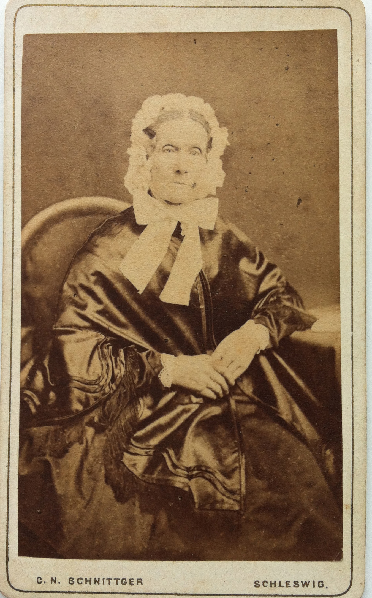{width=150}](/wp-content/uploads/2013/05/p1.png)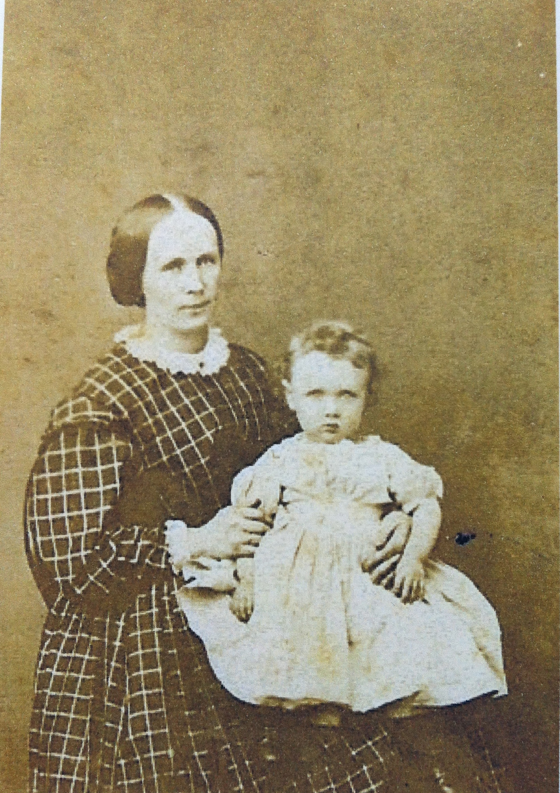{width=150}[{width=150}](/wp-content/uploads/2013/05/Carl.png)[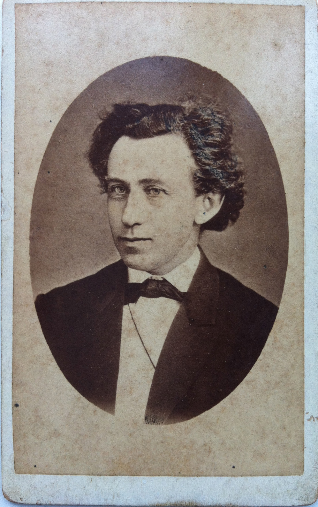{width=150}](/wp-content/uploads/2013/05/p4.png)

> Til Aften blev vi budt ind til Forpagterens, hvor der serveredes Byggrød og Mælk, intet videre, hvorefter Pigerne, Jomfruen og vi andre anbragtes efter Rangforordning langs den ene Væg, Grossmutter og Fruen i Sofaen bag det runde Bord. Forpagteren læste nu et Stykke af en Andagtsbog, efter at en Salme var sunget, derefter rejste alle sig, mens han bekendte Troen og bad en Bøn, hvorpaa der sagdes god Nat, og hver søgte til sit. Denne Andagt var noget aldeles fremmed for mig, men når jeg saa paa Lawaetz under Aftenbønnen, da fik jeg se et Par øjne, som lyste og brændte af Inderlighed og Tro; det glemmer jeg aldrig; det gav et helt andet Indtryk af ham, end da han modtog mig saa fremmed.”

Da Ladegårdens ejer I 1866 selv ville drive jordene, opsiger han forpagtningen, men mejeriforpagtningen beholder Otto, og han får tilbudt at købe Refsnæsgården. Her flytter Otto og Charlotte så ud med deres nu 7 børn, mens Sophie og Carl bliver på Ladegården for at forestå mejeriforpagtningen.\
De næste år er gode og lykkelige og med megen frodighed og virke både i hjemmt, på mark og i stald – samtidig med at Otto var meget optaget og engageret i det samfund, han jo også var en del af.

(Igen kunne der fortælles længe om både Ottos virke og da mange børns trivsel på Refsnæsgården, men det bliver måske næste gang, vi mødes. Eller I kan læse meget af det i Slægtsbogen…)

Jeg vil springe til den 10. December 1871, da Charlotte fødet sit 10. Barn (min farfar, Lotter). Charlotte får barselsfeber og dør fire dage senere. (Den betagende afsked med alle børnene og med den elskede Otto skulle I næste unde jer selv at læse…)

Farmor Sophie flytter nu som 63-årig ind på Refsnæsgården og styrer hus og er reservemor.\
Jeg har fundet et vidunderligt fotografi i min farfars fotoalbum fra året efter. Her ser vi den lille Lotter på 1 år, og Fritz på 2 år. De hviler trygt og godt hos deres bedstemor, der altså passede 10 børn og styrede husholdningen!

[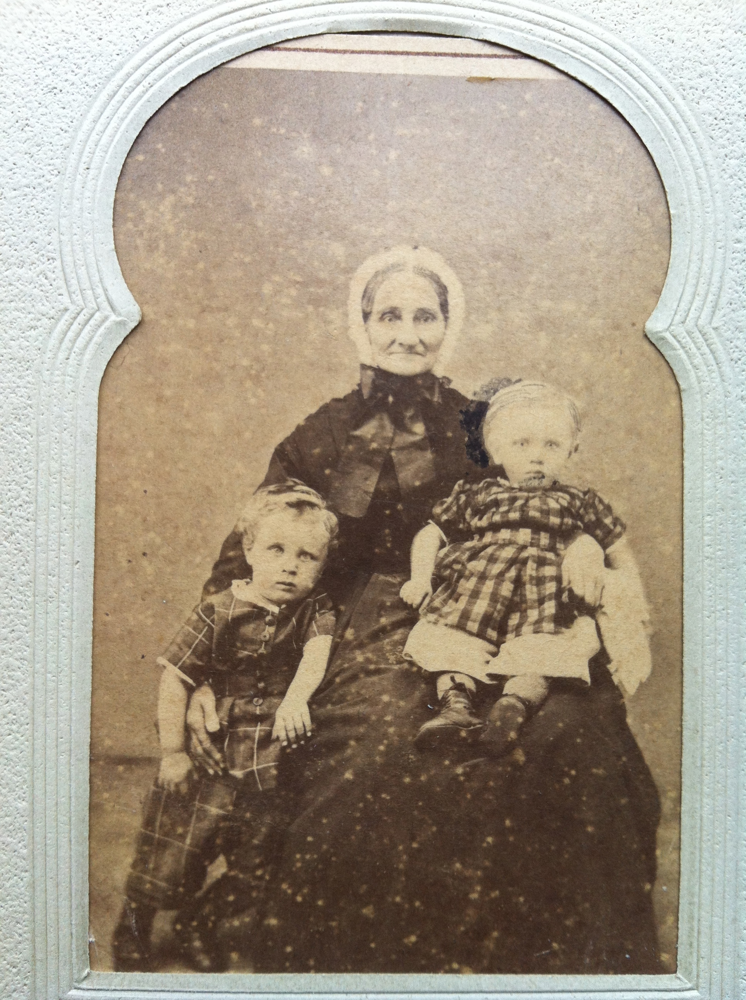{width=150}](/wp-content/uploads/2013/05/LotterFritzMedDeresBedstemoder.png)[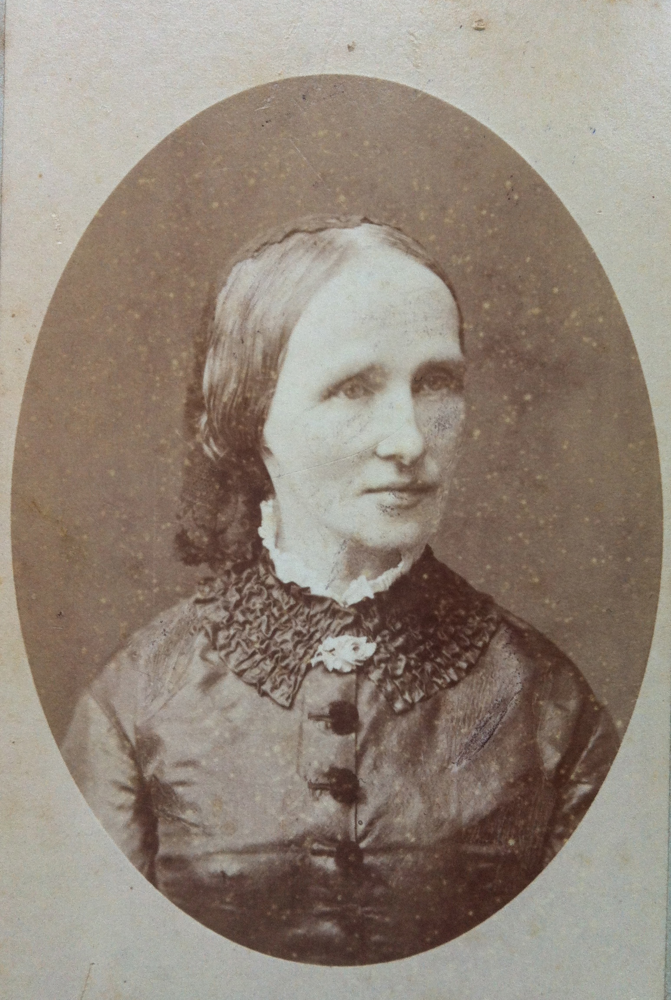{width=150}](/wp-content/uploads/2013/05/TanteToni.png)

Inde på Kålundkloster hos Carl flyttede Charlottes ugifte søster Toni Burchardi ind for at styre hus, men allerede året efter fik bedstemor Sophie en stor opgave derinde. Sønnen Fritz fra Møltrup var blevet alvorligt syg: Måske også tuberkulose. Der hvor han boede på Møltrup, var der ikke til at få tilstrækkelig lægehjælp, så han flyttede over til Kålundkloster, hvor han blev plejet af sin mor; men desværre alligevel døde mindre end et år efter Charlottes død.\
Fritz efterlod sig 8 børn, hvoraf den yngste var 4 måneder og den næstyngste 1 år og 4 måneder. Sønnen Carl på 7 år, der var fulgt med faderen over til Kalundborg for at hjælpe farmoderen med at passe den syge far, blev på Refsnæs, hvor han fik skolegang og sener en landbrugsuddannelse. Ham vil jeg fortælle lidt mere om senere.

[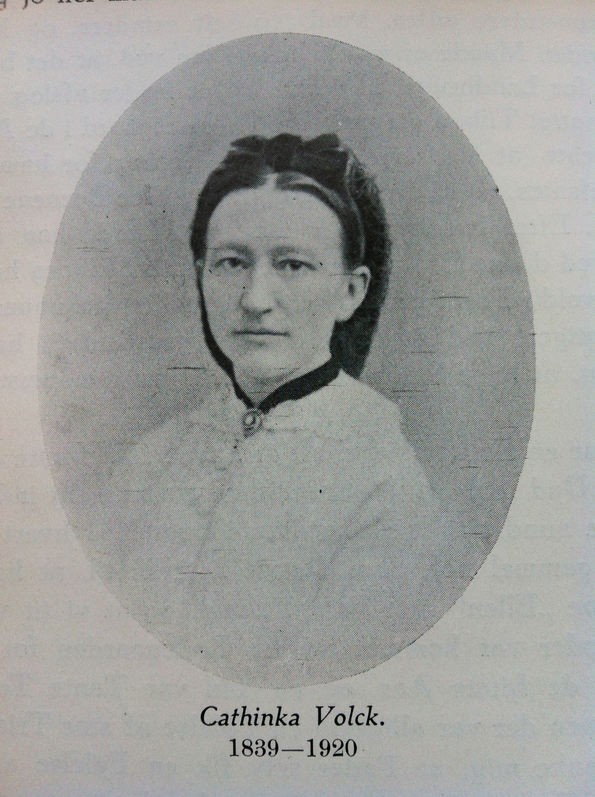{.alignleft width=150}](/wp-content/uploads/2013/05/CatinkaVolk.png)Farmor Sophie drev hjemmet på Refsnæsgård de næste fire år, indtil Otto besluttede sig til at gifte sig igen i 1875. Denne gang med en af børnenes tidligere huslærerinder, Cathinka Volck, som i øvrigt sammen med Otto fik yderligere 6 børn. (Billedet til venstre)

Frits’es enke, Amalie, fik heldigvis hurtigt en forsørger til sig og sin børneflok, idet hun giftede med den nye forpagte på Møltrup.

[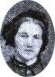{.alignleft}](/wp-content/uploads/2013/05/Amalie.jpg)[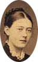](/wp-content/uploads/2013/05/Christine.jpg)\
Amalie dør imidlertid – vist også af tuberkulose – godt 5 år senere , januar1878. Otto tager til begravelsen i Timring Kirke, og da man efter begravelsen drøfter, hvem der skal tage sig af de mange forældreløse børn (Amalies nye mand er muligvis også dødsmærket, for han dør året efter), beslutter Otto, at børnene ikke skal deles, men at han tager dem alle. Det vil sige den ældste datter, Christine, er året før moderens død som 18-årig blevet gift med den nabopræsten – en enkemand og 21 år ældre , med en lille datter, Marie, som vi også kommer til at høre lidt mere om. De to når også at få et barn, inden Christine dør allerede 21 år gammel.

Nå, men Otto tager altså hele børneflokke med sig til Refsnæsgården. Det er jo før telefonernes tid, så han kan ikke nå at fortælle Chatinka om det, før han kommer hjem med børnene. Da han ankommer til hjemmet og til den kone, han kun har været gift med i godt 2 år, må han fortælle, at deres børneflok er øget med 7. Hertil svarer Chatinka de berømte ord: ”Tak for tilliden, Otto”. Ja, hun var i sandhed en hengiven og opofrende kvinde. En god og varm mor, fortæller også min farfar.

Nu skal jeg lige vende tilbage til Carl August. Den Carl, der som 7-årig kom til Refsnæsgården efter faderen Fritz’ død. Carl beslutter sig til som 25 årig at drage ud i Verden, nærmere betegnet til den danske koloni, Dansk Vestindien, hvor hans fætter Hermann, en af Ottos sønner, på det her tidspunkt er præst. Det går Carl godt derude, så da han 6 år senere havde sparet penge nok sammen, tager han hjem til Danmark for at besøge familien. Her møder han Marie, den afdøde søsters plejedatter, som han havde kendt som barn. Carl rejser tilbage til Sct.Croix for at passe sin plantage, men friede efterfølgende pr. brev til Marie, som ankom til Vestindien med skib i 1902. Med sig havde hun penge til en returbillet. Penge som hendes far i al hemmelighed havde givet hende med ved afrejsen med besked om at vende hjem, hvis hun ikke trivedes i troperne. Marie trivedes, og hun giftede sig med Carl kort efter ankomsten. Disse to er stamforældre til den Vestindiske gren af familien. Så fik vi også den gren på plads!

[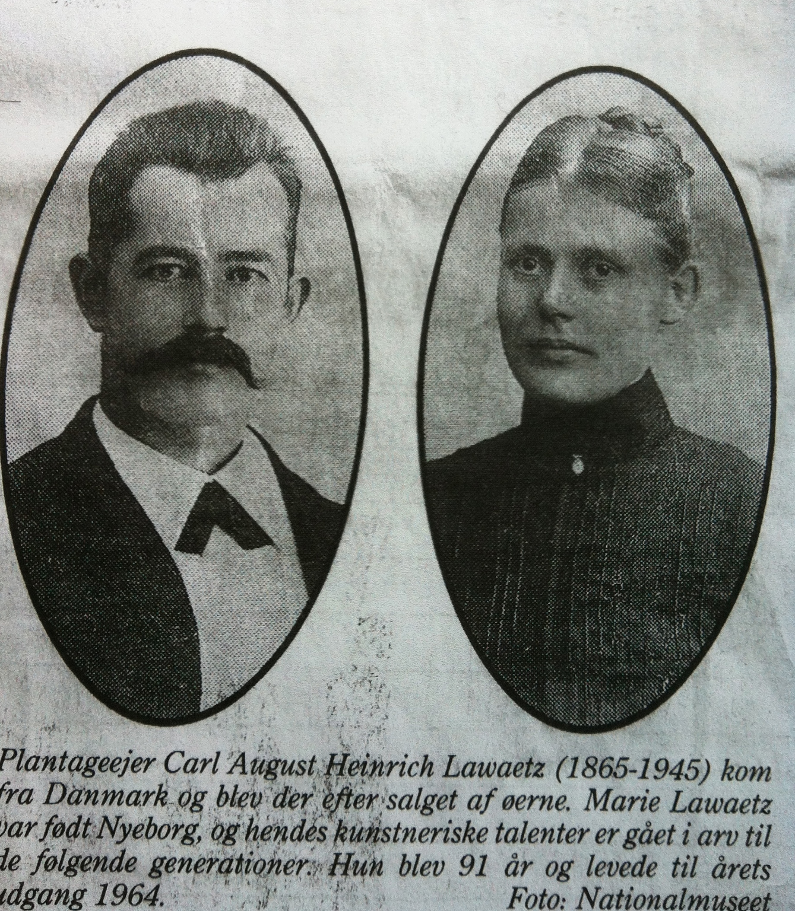{width=262}](/wp-content/uploads/2013/05/CarlAugustHeinrichLawaetz.png)

Som I kan se på gravstenen, dør Sophie 30. Juni 1882, kort efter sin 74 års fødselsdag. Omtalte barnebarn Hermann skriver herom:

> ”I Sommeren 1882 døde min Bedstemoder paa Kalundborg Ladegaard 74 år gammel. Hun havde jo arbejdet meget i sin Tid og led til Stadighed af Gigt, som hun havde paadraget sig i mejeriet. Vi Børn holdt alle meget af hende, og det havde vi ogsaa Grund til. Her paa Kalundborg Ladegaard boede hun altsaa sammen med Onkel Carl og havde det hyggeligt og godt og glædede sig over sin lille Rosenhave udenfor Vinduerne og over tit at faa Besøg af Fader, der gerne bragte et par af Børnene med. Og ofte kom hun jo ogsaa i Besøg paa Refsnæsgaard, ligesom hun som foran fortalt i flere Aar efter Moders Død styrede Huset paa Refsnæsgaard. Jeg har et levende Indtryk af den sønlige Ærbødighed – jeg kan ikke finde noget andet Udtryk for det, som fader udviste overfor Bedstemoder.”

[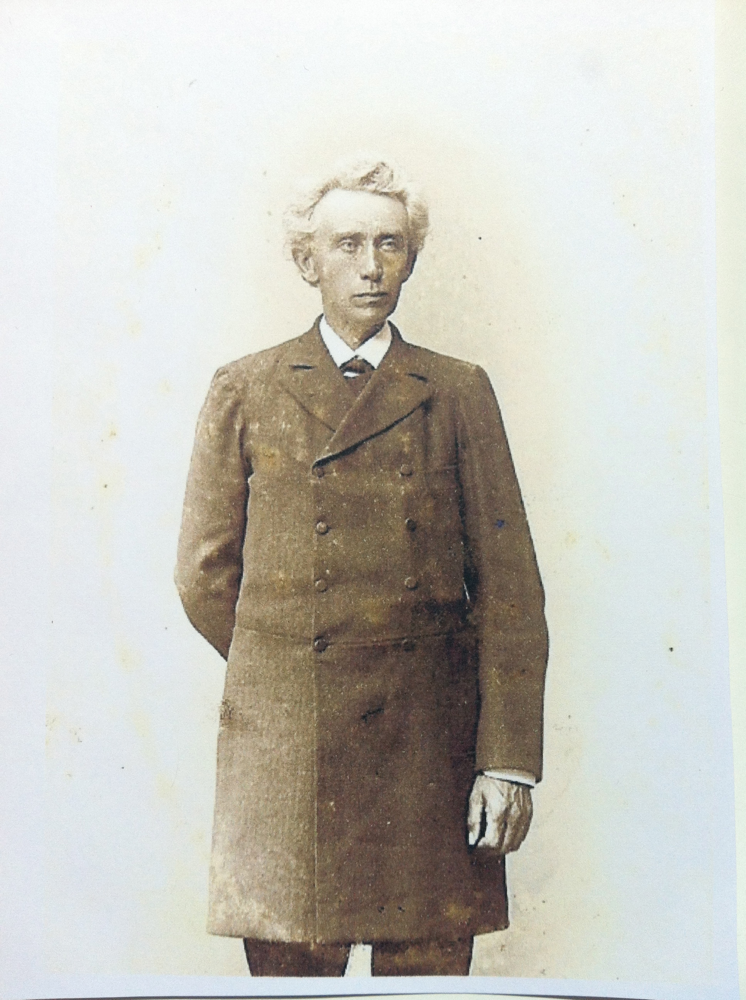{width=224}](/wp-content/uploads/2013/05/LotterLawaetz.png)

Min farfar, Lotter, der var knap 10 år, da bedstemoderen dør, skriver i sine erindringer:

> ” Kun var jeg noget oftere ude hos Bedstemoder paa Ladegaard. Jeg er altid blevet meget forkjælet og det undrer mig. Jeg tror jeg bliver det endnu. Bedstemoders Fødselsdag var den gang den dejligste dag jeg kjendte. Da var Sommeren i sin fulde Pragt og alle saa saa glade ud. Den sidste dag jeg saa min Bedstemoder var paa hendes sidste Fødselsdag. Jeg var jo den gang en lille Dreng og anede ikke at der kun var nogle faa Dage tilbage til at min Bedstemoder atter skulde mødes med Bedstefader der for saa mange Aar siden var gaaet bort men som hun elskede til sin Død. Hun var en sjælden kvinde og jeg har aldrig hørt andet end godt om hende. ”

Carl, der i ca 20 år bestyrede Ladegården – og i de seneste år havde Ottos datter, Marie, styret hus for ham, købte selv en gård, Helgenæs, ved Nakskov, som han drev en del år. Senere trak han sig tilbage på en mindre gård. Han døde ugift i 1912 og testamenterede sin ikke ubetydelige formue til sine broderbørn – især til dem med navnet Carl…

[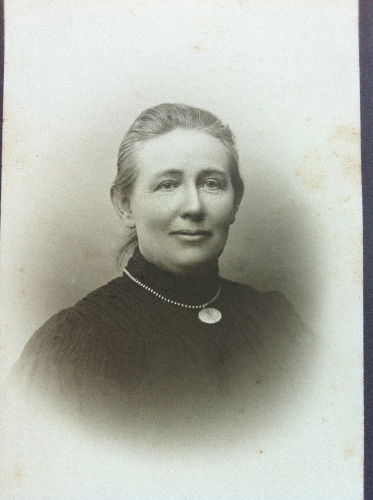{width=150}](/wp-content/uploads/2013/05/Marie-CarlsBroderdatter.png)[{width=150}](/wp-content/uploads/2013/05/Carl.png)

Også om ham skriver Herman:

> ”Onkel Carl var en Spartaner i sin Levevis. Skønt altsaa velstillet i en Aarerække anvendte han det mindst mulige paa sig selv. Dog var han kun paaholdende overfor sig selv. Han var ikke saa lidt af en Filosof og interesserede sig meget for Historie.(Jeg tror, at han ville være rigtig glad for, at vi står her nu…) Han var i besiddelse af meget Lune og var i det hele det hyggeligste Selskab , man kan tænke sig. mens han sad og røg smaat, men flittigt paa sin halvlange Pibe. Han var trofast i al sin Færd mod Fader – det husker jeg netop, at Fader særligt har fremhævet – og han var trofast mod hans Børn, og derfor, og ogsaa fordi han i saa mange Aar samarbejdede med fader, hvem han stod saa nær, bør han mindes særligt i Slægten”

Nu mangler vi lige den sidste sten: Otto Apoteker. Den næstyngste af Møltrup-børnene, der kom til Refsnæsgården. Jeg ved, at han blev student fra Sorø Akademi, og at han senere blev apoteker i Århus. Også han døde ugift, så hvad var mere nærliggende end at få sin urne sat ned her hos sin far, Fritz, og hos farmor Sofie.

_Samlet og nedskrevet af A.10.4.5 Marianne Lawaetz_
