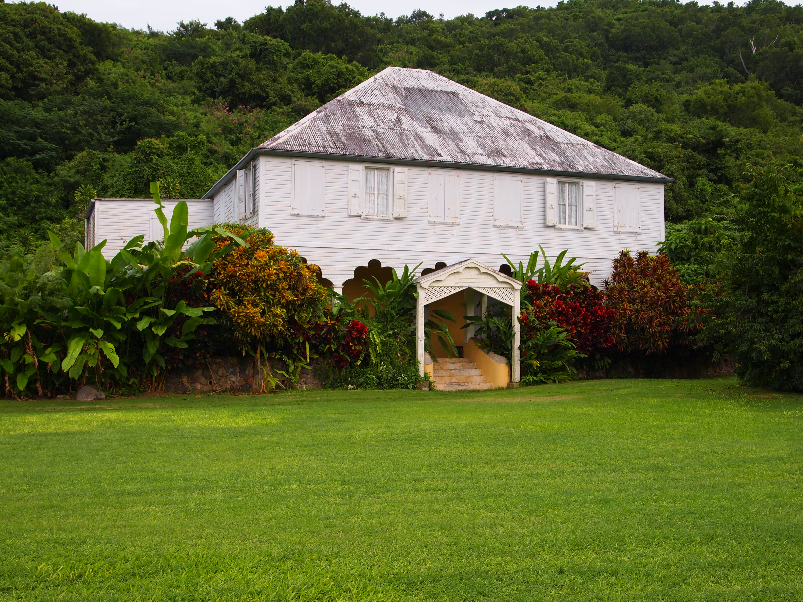
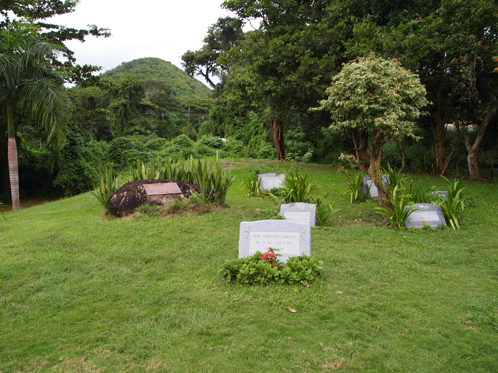
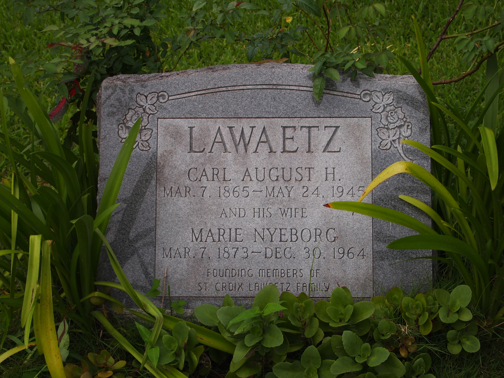
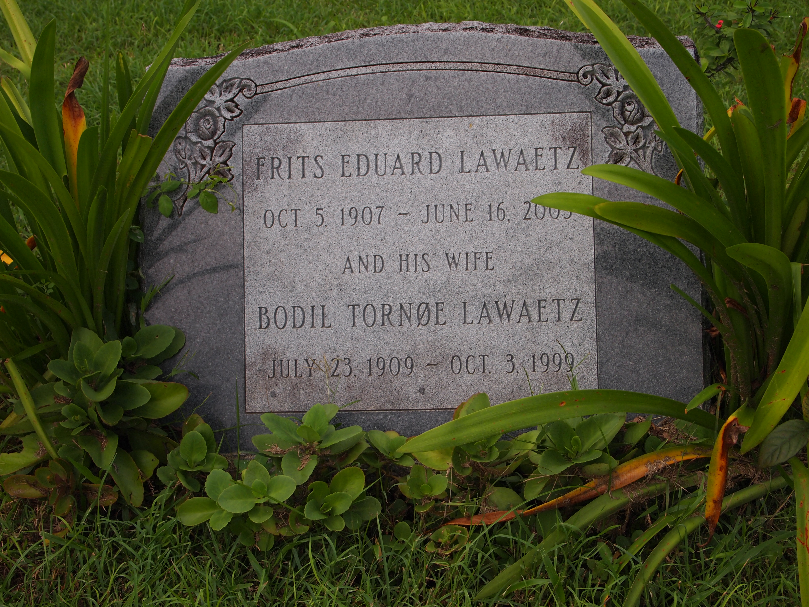
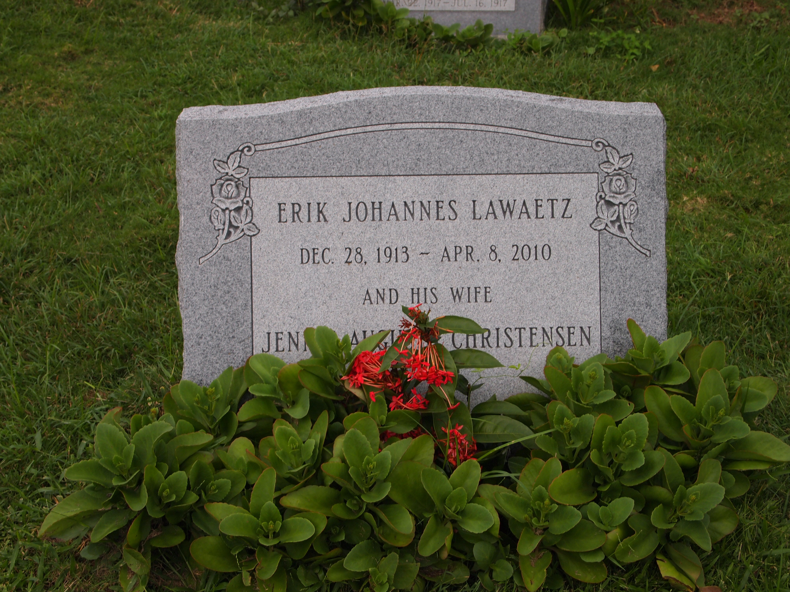
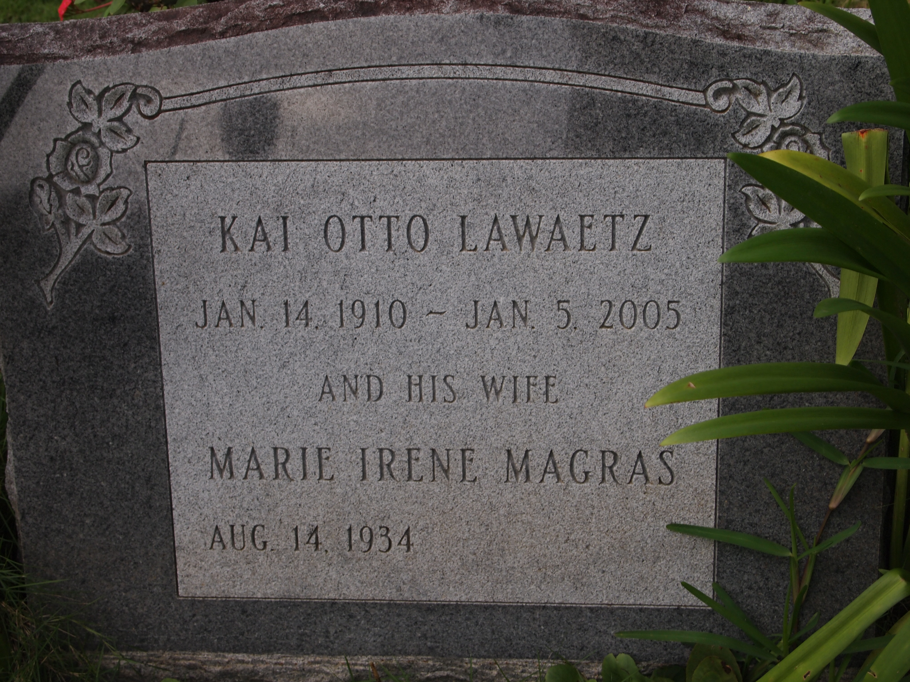
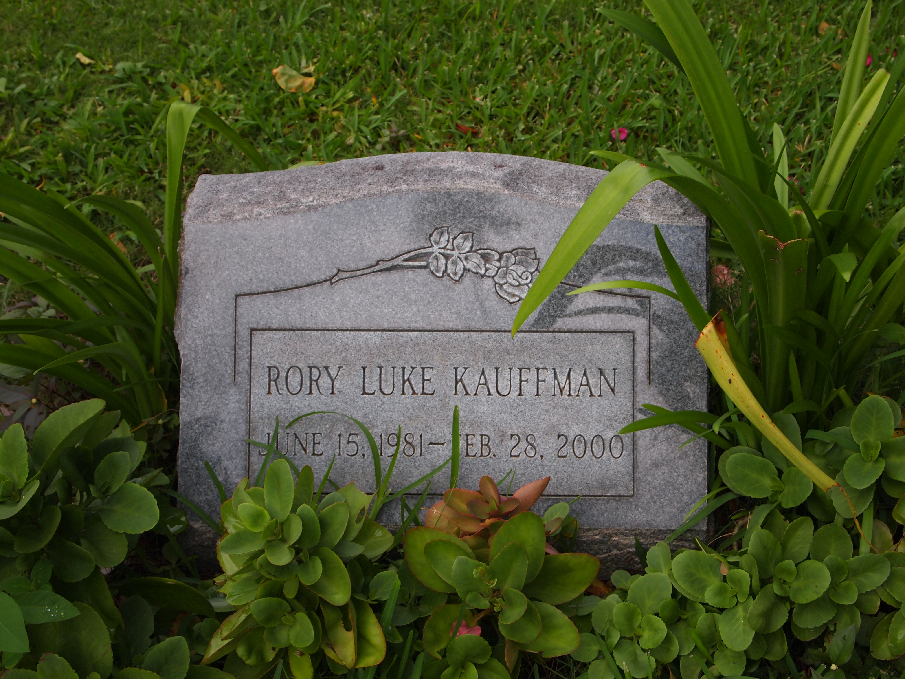
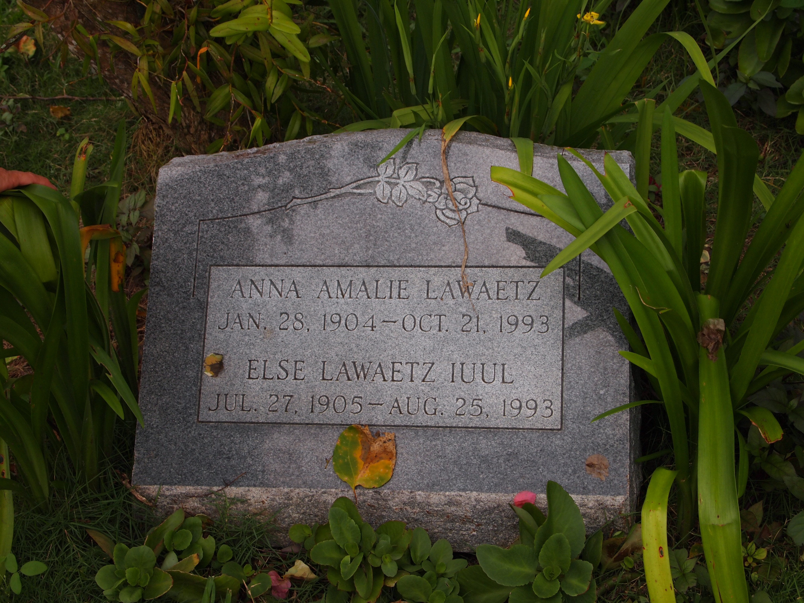

Billederne er taget i efteråret 2011 af Niels og Estrid Lawaetz ved deres besøg på Little La Grange, hvor Hans Lawaetz viste rundt.

Carl Lawaetz overtog Little La Grange i 1895. Carl og hustruen Marie samt deres børn er begravet i et fælles gravsted på grunden.

{width=150}
{width=150}
{width=150}
{width=150}
{width=150}
{width=150}
{width=150}
{width=150}
