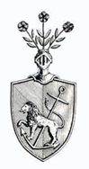
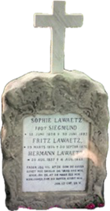
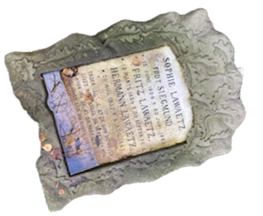
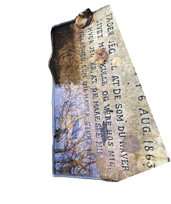
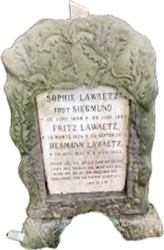

Kære familiemedlemmer\
Rigtig mange af jer læsere af dette nyhedsbrev var deltagere til familiesammenkomsten på Falkensteen den 24. maj 2025. En festlig dag med 170 deltagere. Tak for de mange dejlige tilbagemeldinger til festudvalget. Og EN STOR TAK til Ida og Carl Aage på Falkensteen, fordi vi måtte være gæster hos jer. Tak for jeres store forarbejde og det dejlige samarbejde med festudvalget. Man følte sig meget velkommen på jeres smukke Falkensteen.\
Festudvalget er nu ved at planlægge næste Lawaetz-familiesammenkomst, som bliver på Refsnæsgården (Røsnæs Naturskole) og i Fiskerhuset lørdag den 20. maj 2028.\
Sæt allerede nu X i kalenderen! Indbydelser sendes ud i januar 2028.

Legatet har lige nu især to nyheder. Den ene er rigtig god, og den anden er mindre god.\
Vi tager den gode nyhed først:\
Ved familiesammenkomsten på Falkensteen fik vi et tilbud fra en af vore engelske slægtninge, Thomas Olesen A.11.5.4. fra Norfolk i England, som gerne ville oversætte vores slægtsbog “Otto Lawaetz, hans Liv og Gerning tillige med Blade af Slægten Lawaetz’s Historie” til engelsk. Oversættelsen er nu udført, og vi takker Thomas mange gange for det grundige og fine oversættelsesarbejde. Nu findes der således en fil med slægtsbogen på engelsk, og Thomas har desuden sat billederne ind og tilføjet adskillige uddybende noter.\
TUSIND TAK FOR DET!\
Filen af den engelske udgave af slægtsbogen er nu i Legatets besiddelse, og interesserede familiemedlemmer kan rekvirere filen hos legatet på samme sted som den fysiske danske bog: Bestillingen kan sendes til mig, legatets formand, Marianne Lawaetz, og man kan benytte min direkte mail: mariannelawaetz@gmail.com. Send gerne stamtavlenummer med ved bestillingen.\
Vi har i bestyrelsen valgt ikke at sætte en fast pris på at få tilsendt filen med den engelske oversættelse. Vi vil i stedet være taknemmelige for at modtage et bidrag til Det Otto Lawaetz-eske Familielegat på legatets kontonummer i Jyske Bank: 5066 1521091.\
(Ved pengeoverførsel fra udlandet skal yderligere oplyses legatets IBAN kontonr.: DK 6450660001521091 og SWIFT/BIC address: JYBADKKK)

Faktisk har vi endnu en glædelig bognyhed: Der eksisterer også en tysk oversættelse af slægtsbogen. Ulf Lawaetz A.6.1.1. foretog denne oversættelse i 1973, og nu tilbyder hans nevø, Gerd Sigel A.6.1.4.4. fra Boostedt nær Neumünster i Tyskland at sende et eksemplar af den tyske oversættelse til særligt interesserede familiemedlemmer. Også ved denne bestilling bedes man sende sit stamtavlenummer med ved bestillingen, så ved man lidt mere om, hvem hinanden er. Gerd Sigels mailadresse er gerd.sigel@googlemail.com

Og så til den triste nyhed\
Der er begået groft hærværk og tyveri på familiegravstedet på Kalundborg Kirkegård. 
Det er gået ud over den smukke og forholdsvis nyistandsatte gravsten over Sophie Lawaetz (hustru til Carl Wilhelm Lawaetz, der som bekendt er begravet på Gjellerup Kirkegård).
På stenen er også navnene på to af deres sønner: Fritz Lawaetz (stamfader til Sct.Croix-grenen) samt unge Hermann Lawaetz.

\
Som det ses af billederne, er stenen væltet omkuld og marmorkorset er knækket af og forsvundet. Gravstenen, der er fra 1863, havde legatet i 2016 fået mulighed for at få en meget dygtig stenhugger til at restaurere – takket være en stor anonym gave – og stenen stod meget smukt på gravstedet på Kalundborg Kirkegård (første billede) Da vi opdagede hærværket, fik vi omgående Stenhuggeren, som også havde udført den fine istandsættelse i 2016, til at rejse stenen op igen, så den ikke tog yderligere skade. Hærværket er meldt til politiet, som efter diverse undersøgelser i deres arkiver har meddelt, at det er nytteløst lige nu at gå videre med sagen.\
Desværre har Legatet ikke aktuelt midlerne (8.000 kr.) til at få sat nyt marmorkors på igen, og yderligere 2-4.000 kr., hvis stenhuggeren samtidig skal rense marmor-navnepladen og sandstenen, mens gravstenen alligevel er på deres værksted. Så istandsættelsen må vente.\
Legatet må spare sammen… Stenen er rejst op og tager ikke yderligere skade (sidste billede).\
Hvem er nu lige Sophie? Ja, hun og hendes ægtemand, Carl Wilhelm var de første Lawaetz’ere med ae, der sammen med deres fire sønner kom til kongeriget. 
De kom i 1838 fra Holsten og ernærede sig ved mejeriforpagtninger på forskellige store herregårde.\
Holstenere var på den tid kendte for deres særlige dygtighed omkring mejeridrift, og Carl Wilhelm, Sophie og siden deres ældste søn, Otto, var ingen undtagelse. (Da der år senere i Danmark blev oprettet andelsmejerier, byggede man bl.a. på den viden, som de holstenske mejerister bragte med til landet). En af Carl Wilhelms mejeriforpagtninger var på Herningsholm, og hans forpagtningskontrakt eksisterer faktisk endnu. Den kan om kort tid læses i sin fulde udstrækning på familiens hjemmeside (familien-lawaetz.dk), hvis nogen skulle have lyst til at gå i dybden med forholdene hos en mejeriforpagterfamilie i 1844-47. I Otto Lawaetz-bogen på siderne 57-59 fortæller den da 15-årige Ottos om sin oplevelse af forholdene på Herningsholm den første sommer.\
Da Sophie ganske få år senere blev enke, fortsatte hun med mejeriforpagtning med den ældste søns hjælp.\
Mange år senere i 1871, da Ottos første hustru, Charlotte, døde i barselssengen med det 10.\
barn, flyttede den gamle farmor Sophie på nu 63 år, ind på Refsnæsgården og passede både de 10 børn og den store husholdning.\
En gæv kvinde, som der kan læses meget mere om i slægtsbogen.\
Nu har jeg nævnt slægtsbogen “Otto Lawaetz, hans Liv og Gerning tillige med Blade af Slægten Lawaetz’s Historie” en del gange. Den og de øvrige familiebøger, der så grundigt er omtalt i de forrige nyhedsbreve, kan stadig bestilles hos mig, legatets formand, Marianne Lawaetz. Købere kan benytte min direkte mail: mariannelawaetz@gmail.com .\
“Otto Lawaetz, hans Liv og Gerning tillige med Blade af Slægten Lawaetz’s Historie” er nummereret, indbundet i gråt lærredsbind og med guldtryk. Pris: 250 kr.\
”Carl Lawaetz, Kaalund Kloster, 1868-1944”. Hæfte, kan købes for 100 kr.\
”Ludolph Gabe. Københavns Valgmenigheds første formand. Hans selvbiografi.” Dette hæfte kan erhverves for 50 kr.\
Ved bogbestillinger bedes foruden postadresse oplyst både mailadresse og telefonnummer. Og gerne stamtavlenummer. Som noget nyt fra sidste år sendes bøgerne nu fragtfrit.\
Så mangler jeg vist kun at minde jer om, at nogle af jer af og til har nævnt, at I mangler at opdatere stamtavlen med nye børn, børnebørn, svigerbørn, dødsfald osv. Måske er det nu, en opdatering af stamtavlen skal foretages…\
Nikolaj Lorentzen A.8.3.4.1. står stadig for rettelser til stamtavlen samt opdateringer af mailadresser. Det kan ske gennem familiens hjemmeside: familien-lawaetz.dk og mailadressen stamtavle@familien-lawaetz.dk, så går der direkte besked til Nikolaj.\
Måske skal jeg også lige her til sidst minde om, at gaver til Det Otto Lawaetz-eske Familielegat modtages med stor tak – og at gaver lige nu falder på et temmelig tørt sted.\
Legatets kontonummer i Jyske Bank: 5066 1521091.\
Ved overførsel fra udland tillige: IBAN kontonr.: DK 6450660001521091 og SWIFT/BIC address: JYBADKKK (Angiv gerne navn og mailadresse, så vil vi kvittere med at sende en opdateret stamtavle.)\
Med disse ord vil jeg på legatbestyrelsens vegne sende jer alle de varmeste og bedste ønsker for et godt 2026.

Mange hilsener\
Marianne Lawaetz

Legatbestyrelsen:\
Marianne Lawaetz (formand, hjemmeside og salg af bøger) A.10.4.5\
Erik Anders Lawaetz (kasserer) A.8.3.1.2\
Carl Martin Gabe A.8.6.5.2\
Samt suppleant: Carl Lawaetz Gabe A.8.6.2

Festudvalget består af\
Clara Lawaetz (formand) A.8.3.6.\
Carl Lawaetz Gabe A.8.6.2.\
Marianne Lawaetz A.10.4.5.\
Charlotte Kirstine Gabe Westen A.8.6.2.1.\
Camilla Nøjgaard A.8.3.2.4.\
Mads Lawaetz A.10.4.5.2.\
Nikolaj Lorentzen (stamtavle og mailadresser) A.8.3.4.1.
